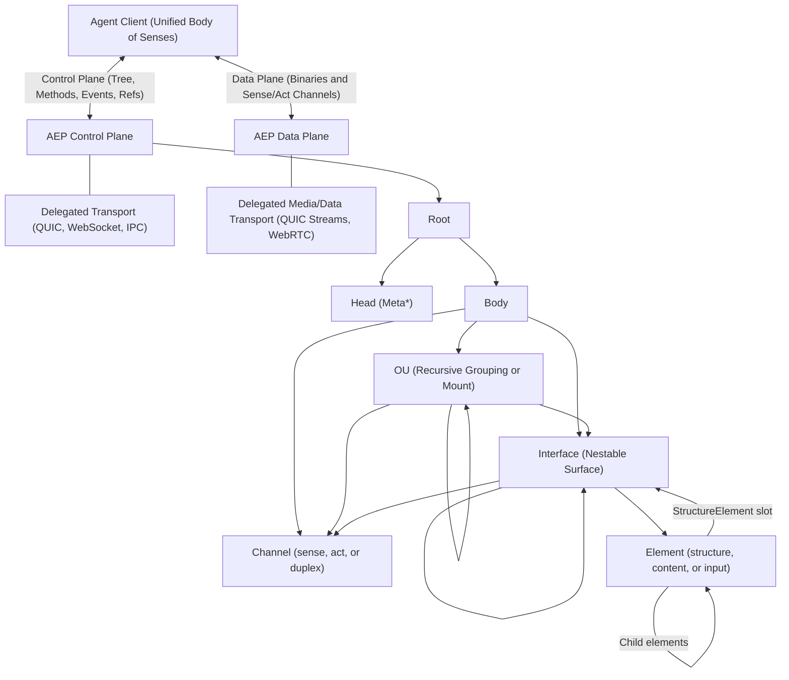

# 00 — Overview & Architecture

## 1. Scope & Objectives

The **Agent Environment Protocol (AEP)** enables autonomous agents to observe, sense, reason over, and act within arbitrary target environments—including desktops, browsers, terminals, mobile devices, cloud workspaces, and physical robotic systems.

AEP adheres to five core design constraints:

- **Language-Agnostic**: Protocol semantics, grammar productions, data models, and RPC contracts avoid bindings to any single programming language or runtime.
- **Transport-Agnostic**: AEP governs the **Control Plane** and **Data Plane** while delegating transport, framing, encryption, and low-level networking mechanics to external transport protocols. See [05 — Transport & Interoperability](./05-transport-and-interop.md).
- **Binary-First with Lossless JSON Equivalence**: Structured Control-Plane objects prefer compact binary serialization (such as Protocol Buffers) with lossless JSON representation for debugging and browser/text transports.
- **Server-Side Authority (No Client Scripting)**: Environments are projected as server-owned semantic trees carrying declarative metadata and invokable methods. Clients MUST NOT execute embedded client-side scripts or mutate server state locally; all state transitions occur server-side and propagate over the Control Plane.
- **Open Semantic Taxonomy**: Core AEP defines a minimal, strict structural grammar while keeping domain types (`TypeTag`) and node metadata (`Meta`) completely open-ended. Core parsers never break on new environment types or modalities.

---

## 2. The "Body of Senses" Model

Traditional environment protocols force diverse targets into fixed, domain-specific hierarchies (such as assuming every environment is an operating system running windowed desktop processes). AEP replaces fixed semantic tiers with a **modular passthrough I/O tree**:

- A **single AEP client** forms one unified client runtime that can connect to one or multiple AEP servers simultaneously.
- Each connected provider projects a subtree of **Organizational Units (`OU`)**, **Interfaces (`Interface`)**, **Elements (`Element`)**, and **I/O Channels (`Channel`)** under `Body`, alongside session and capability metadata in `Head`.
- Because every provider speaks the same recursive tree grammar, an AEP server or client can transparently mount subtrees from other AEP providers ([03 — Passthrough & Composition](./03-passthrough-and-composition.md))—assembling desktops, embedded terminals, browser iframes, microphones, depth cameras, and robotic actuators into one coherent **body of senses and actuation**.

---

## 3. Boundary of Concerns

AEP separates communication into two protocol planes and delegates transport below them:

1. **Control Plane**:
   - Operates over a continuous, event-driven, bidirectional connection.
   - Carries session handshake (`session.initialize`), `Head` metadata, tree inspection and search (`tree.get`, `tree.query`, `node.get`, `node.loadChildren`), server-side method calls (`node.invoke`), incremental tree mutations and events (`node.added`, `node.updated`, `node.removed`, `node.event`), and lightweight Data-Plane references (`BinaryRef`, `StreamRef`).
2. **Data Plane**:
   - Transfers discrete binary snapshots/blobs (`data.getBinary` with structured parameters) and continuous or seekable I/O streams (`channel.open`, `channel.send`, `channel.seek`, `channel.sample`, `channel.close`, `channel.chunk`).
   - Uses agent-centric channel directionality (`sense`, `act`, `duplex`) so sensory input, actuation output, and closed-loop telemetry share one unambiguous model.
3. **Transport & Networking (Delegated)**:
   - Delegated to underlying transports—ideally **QUIC** for secure, multiplexed, durable Control-Plane and Data-Plane streams without head-of-line blocking, and **WebRTC** for real-time audio, video, and low-latency peer telemetry tracks. See [05 — Transport & Interoperability](./05-transport-and-interop.md).

---

## 4. Connection Requirements

Any transport binding carrying production AEP sessions MUST satisfy five operational guarantees:

- **Security**: Confidentiality and integrity protection in transit.
- **Authentication**: Verifiable peer identity and authorization before exposing environment trees or invoking mutating methods or actuation channels.
- **Reliability**: Reliable, ordered delivery for Control-Plane state transitions, incremental tree mutations, and method invocations.
- **Performance**: Low-latency, multiplexed execution avoiding head-of-line blocking between Control-Plane messages and high-throughput Data-Plane streams.
- **Durability**: Connection resilience across continuous, long-lived, event-driven agent sessions.

> **Local/Development Mode & Partial Profiles**: Implementations targeting a partial subset (such as `aep-core-static`) or local/development setups MAY negotiate `security.mode = "unauthenticated"` and declare explicit capabilities during `session.initialize`. See [06 — Profiles, Sessions & Vocabularies](./06-profiles-sessions-and-vocabularies.md).

---

## 5. High-Level Tree Structure

Every AEP projection is rooted at a single `Root` containing `Head` and `Body`:

```text
Root
 ├── Head (Meta*)
 └── Body (OU | Interface | Channel)*
      ├── OU (NodeHeader + (OU | Interface | Channel)*)
      ├── Interface (NodeHeader + (Element | Interface | Channel)*)
      │    └── Element (structure | content | input)
      │         ├── StructureElement ──▶ (Element | Interface)*
      │         ├── ContentElement   ──▶ Element*
      │         └── InputElement     ──▶ Element*
      └── Channel (NodeHeader + ChannelSpec [sense | act | duplex])
```

See [01 — Formal Grammar](./01-formal-grammar.md) for the complete normative EBNF specification and [02 — Tree Nodes & Data Model](./02-tree-nodes.md) for field-level semantics.

---

## 6. Architecture Overview Diagram



---

## 7. Related Documents

- [01 — Formal Grammar](./01-formal-grammar.md)
- [02 — Tree Nodes & Data Model](./02-tree-nodes.md)
- [03 — Passthrough & Composition](./03-passthrough-and-composition.md)
- [04 — Control & Data Planes](./04-control-and-data-planes.md)
- [05 — Transport & Interoperability](./05-transport-and-interop.md)
- [06 — Profiles, Sessions & Vocabularies](./06-profiles-sessions-and-vocabularies.md)
- [07 — Scenarios & Examples](./07-scenarios-and-examples.md)
