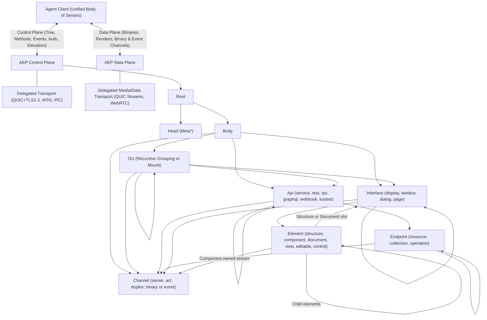

# 00 — Overview & Architecture

## 1. Scope & Objectives

The **Agent Environment Protocol (AEP)** enables autonomous agents to observe, sense, reason over, and act within arbitrary target environments—including desktops, browsers, terminals, mobile devices, cloud workspaces, and physical robotic systems.

AEP adheres to five core design constraints:

- **Language-Agnostic**: Protocol semantics, grammar productions, data models, and RPC contracts avoid bindings to any single programming language or runtime.
- **Transport-Agnostic**: AEP governs the **Control Plane** and **Data Plane** while delegating transport, framing, encryption, and low-level networking mechanics to external transport protocols. See [05 — Transport & Interoperability](./05-transport-and-interop.md).
- **Binary-First with Lossless JSON Equivalence**: Structured Control-Plane objects prefer compact binary serialization (such as Protocol Buffers) with lossless JSON representation for debugging and browser/text transports.
- **Server-Side Authority (No Client Scripting)**: Environments are projected as server-owned semantic trees of objects carrying declarative `properties`, live `state`, invokable `methods`, `events`, and optional auxiliary `meta`. Clients MUST NOT execute embedded client-side scripts or mutate server state locally; all state transitions occur server-side and propagate over the Control Plane.
- **Open Semantic Taxonomy**: Core AEP defines a minimal, strict structural grammar alongside reserved core UI surface, layout, document, and primitive types while keeping domain types (`TypeTag`), node `properties`/`state`, and auxiliary `meta` completely open-ended. Core parsers never break on new environment types or modalities.

- **AEP Configuration & Mount Manifests**: Servers, clients, TLS/authentication policies, and passthrough mounts can be declared deterministically via `aep.config.json` ([09 — Configuration & Passthrough Mount Manifests](./09-configuration.md)).

---

## 2. The "Body of Senses" Model

Traditional environment protocols force diverse targets into fixed, domain-specific hierarchies (such as assuming every environment is an operating system running windowed desktop processes). AEP replaces fixed semantic tiers with a **modular passthrough I/O tree**:

- A **single AEP client** forms one unified client runtime that can connect to one or multiple AEP servers simultaneously.
- Each connected provider projects a subtree of **Organizational Units (`OU`)**, **Visual Surfaces (`Interface`)**, **Headless Programmatic Services (`Api`, `Endpoint`)**, **Elements (`Element`: `structure`, `component`, `document`, `view`, `editable`, `control`)**, and **I/O & Event Channels (`Channel`)** under `Body`, alongside session, security, and capability metadata in `Head`.
- Because every provider speaks the same recursive tree grammar, an AEP server or client can transparently mount subtrees from other AEP providers ([03 — Passthrough & Composition](./03-passthrough-and-composition.md))—assembling desktops, embedded terminals, browser iframes, headless REST/RPC APIs, microphones, depth cameras, and robotic actuators into one coherent **body of senses and actuation**.
- **Distributed Passthrough & Load Balancing**: Complex cloud or fleet environments (such as multi-region cloud consoles) MAY be served behind L4/L7 load balancers and elastic backend pools; optional stable logical node identifiers (`uid`), `node.moved` relocation notifications, and `session.resume` sequence watermarks allow unified trees and open `Channel`s to survive shard rebalancing and gateway failover transparently.

### 2.1 Multi-Agent & Dual-Speed ("System 1 / System 2") Harnesses

AEP provides a multi-I/O substrate that serves both request-driven deliberation and continuous event-driven reflexes without prescribing agent cognition:

- **System 1 (Fast Reflex / Event-Driven Loops)**: Subscribe directly to `Channel` streams (`payloadMode = "binary"` or `"event"`) and `node.event` notifications to react to telemetry, audio/video frames, or operational alerts in real time with zero head-of-line blocking.
- **System 2 (Slow Planning / Request-Driven Loops)**: Inspect trees (`tree.query`), obtain low-token visual groundings (`data.render` with `renderMinimal`), invoke methods (`node.invoke`), and request step-up elevation (`session.elevate`) concurrently over the same session or via separate `multi-controller` / `observer` sessions.
- **Safe Multi-Agent Coordination**: Multiple agents or dual-speed loops operate concurrently on disjoint `Channel`s and subtrees, coordinated optionally via cooperative subtree leases (`session.acquireLease` / `session.releaseLease`) and optimistic concurrency (`revision` / `expectedRevision`).

---

## 3. Boundary of Concerns

AEP separates communication into two protocol planes and delegates transport and IAM concerns outside the protocol:

1. **Control Plane**:
   - Operates over a continuous, event-driven, bidirectional connection.
   - Carries session handshake (`session.initialize`), session resumption (`session.resume`), authentication and step-up privilege elevation (`session.authenticate`, `session.elevate`, `session.dropElevation`), cooperative subtree leases (`session.acquireLease`, `session.releaseLease`), `Head` metadata, tree inspection and search (`tree.get`, `tree.query`, `node.get`, `node.loadChildren`), server-side method calls (`node.invoke`), incremental tree mutations and events (`node.added`, `node.updated`, `node.moved`, `node.removed`, `node.event`, `session.authExpiring`, `session.elevationUpdated`, `session.leaseUpdated`), and lightweight Data-Plane references (`BinaryRef`, `StreamRef`).
2. **Data Plane**:
   - Transfers discrete binary snapshots/blobs (`data.getBinary` with structured parameters), multi-tier visual renders (`data.render` supporting `renderMinimal`, `renderExpress`, and `renderFull` alongside deterministic client-side `renderMinimal` synthesis), and continuous, seekable, or structured plain-event I/O streams (`channel.open`, `channel.send`, `channel.seek`, `channel.sample`, `channel.close`, `channel.chunk`).
   - Uses agent-centric channel directionality (`sense`, `act`, `duplex`) and payload modes (`binary`, `event`) so sensory input, actuation output, closed-loop telemetry, and event streams share one unambiguous model.
3. **Transport & Networking (Delegated)**:
   - Delegated to underlying transports—ideally **QUIC** (with TLS 1.3 and `ALPN: "aep/1"`) for secure, multiplexed, durable Control-Plane and Data-Plane streams without head-of-line blocking, **WebRTC** (`DTLS-SRTP`) for real-time audio, video, and low-latency peer telemetry tracks, **`wss://`** for web clients, and OS-authenticated local IPC (`unix`, `named-pipe`, `stdio`). See [05 — Transport & Interoperability](./05-transport-and-interop.md) and [08 — Security, Authentication & Privilege Elevation](./08-security-and-elevation.md).
4. **Identity & Access Management (Delegated)**:
   - AEP is **not** an IAM protocol. The Control Plane allows clients to advertise their identity and supply proof of identity (credentials), while the AEP server handles authentication verification and permission enforcement against its own backing identity provider—whether centralized or device-local. See [08 — Security, Authentication & Privilege Elevation](./08-security-and-elevation.md#11-boundary-of-concerns-aep-is-not-an-iam-protocol).

---

## 4. Connection Requirements

Any transport binding carrying production AEP sessions MUST satisfy five operational guarantees:

- **Security**: Confidentiality and integrity protection in transit (TLS 1.3 / DTLS-SRTP / OS-isolated local IPC).
- **Authentication & Elevation**: Verifiable peer identity, application-layer credentials (`mtls`, `os-peer`, `bearer`, `api-key`, `challenge-response`), and explicit step-up privilege elevation (`session.elevate`) before exposing restricted subtrees or invoking sensitive operations.
- **Reliability**: Reliable, ordered delivery for Control-Plane state transitions, incremental tree mutations, and method invocations.
- **Performance**: Low-latency, multiplexed execution avoiding head-of-line blocking between Control-Plane messages and high-throughput Data-Plane streams.
- **Durability**: Connection resilience and in-session credential rotation (`session.authenticate`) across continuous, long-lived, event-driven agent sessions.

> **Local/Development Mode & Partial Profiles**: Implementations targeting a partial subset (such as `aep-core-static`) or local/development setups MAY negotiate `security.mode = "unauthenticated"` and declare explicit capabilities during `session.initialize`. See [06 — Profiles, Sessions & Vocabularies](./06-profiles-sessions-and-vocabularies.md) and [08 — Security, Authentication & Privilege Elevation](./08-security-and-elevation.md).

---

## 5. High-Level Tree Structure

Every AEP projection is rooted at a single `Root` containing `Head` and `Body`:

```text
Root
 ├── Head (Meta*)
 └── Body (OU | Interface | Api | Channel)*
      ├── OU (NodeHeader + (OU | Interface | Api | Channel)*)
      ├── Interface (NodeHeader + (Element | Interface | Channel)*)         [display, window, dialog, page]
      │    └── Element (structure | component | document | view | editable | control)
      │         ├── StructureElement ──▶ (Element | Interface)*               [form, section, stack, grid, table, column, row, cell]
      │         ├── ComponentElement ──▶ (Element | Interface | Channel)*     [composite widgets owning channels]
      │         ├── DocumentElement  ──▶ (Element | Interface)*               [rich flow text + embedded forms/editables]
      │         ├── ViewElement      ──▶ Element*                             [read-only views]
      │         ├── EditableElement  ──▶ Element*                             [stateful modifiable inputs]
      │         └── ControlElement   ──▶ Element*                             [stateless action triggers]
      ├── Api (NodeHeader + (Endpoint | Api | Channel)*)                     [service, rest, rpc, graphql, webhook, toolset]
      │    └── Endpoint (NodeHeader + (Endpoint | Channel)*)                  [resource, collection, operation, streamEndpoint, webhookEndpoint]
      └── Channel (NodeHeader + ChannelSpec [sense | act | duplex, binary | event])
```

See [01 — Formal Grammar](./01-formal-grammar.md) for the complete normative EBNF specification and [02 — Tree Nodes & Data Model](./02-tree-nodes.md) for field-level semantics.

---

## 6. Architecture Overview Diagram



---

## 7. Related Documents

- [01 — Formal Grammar](./01-formal-grammar.md)
- [02 — Tree Nodes & Data Model](./02-tree-nodes.md)
- [03 — Passthrough & Composition](./03-passthrough-and-composition.md)
- [04 — Control & Data Planes](./04-control-and-data-planes.md)
- [05 — Transport & Interoperability](./05-transport-and-interop.md)
- [06 — Profiles, Sessions & Vocabularies](./06-profiles-sessions-and-vocabularies.md)
- [07 — Scenarios & Examples](./07-scenarios-and-examples.md)
- [08 — Security, Authentication & Privilege Elevation](./08-security-and-elevation.md)
- [09 — Configuration & Passthrough Mount Manifests](./09-configuration.md)
