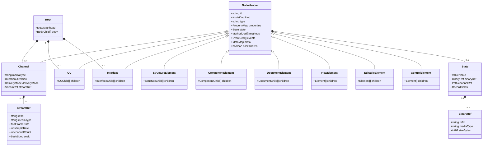

# 02 — Tree Nodes & Data Model

This document specifies the normative semantics, unified object anatomy (`properties`, `state`, `methods`, `events`, `meta`), core built-in types, and Data-Plane references for every node in the **Agent Environment Protocol (AEP)** tree defined in [01 — Formal Grammar](./01-formal-grammar.md).

Related documents: [00 — Overview](./00-overview.md) | [01 — Formal Grammar](./01-formal-grammar.md) | [03 — Passthrough & Composition](./03-passthrough-and-composition.md) | [04 — Control & Data Planes](./04-control-and-data-planes.md) | [06 — Profiles, Sessions & Vocabularies](./06-profiles-sessions-and-vocabularies.md)

---

## 1. `Root`, `Head`, and `Body`

Every AEP projection is rooted at a single `Root` object containing two distinct partitions:

- **`Head` (`Meta*`)**: Session-wide metadata describing the protocol version, server identity, negotiated capabilities, active domain vocabularies, session role/concurrency state, security mode, and clock synchronization metadata.
- **`Body` (`(OU | Interface | Channel)*`)**: The live navigable I/O tree composed of Organizational Units, Interfaces, Elements (`structure`, `component`, `document`, `view`, `editable`, `control`), and Channels.

### Standard Reserved `Head` Keys

`Head` is an open `Meta` map keyed by `NamespacedIdent`. Core AEP reserves the following `aep.*` keys inside `Head`:

| Key | Value Shape | Semantics |
| --- | --- | --- |
| `aep.protocolVersion` | `string` | Active negotiated protocol version (e.g., `"1.0.0-draft"`). |
| `aep.serverInfo` | `{ name, version, description? }` | Provider identity and build version. |
| `aep.capabilities` | `CapabilitiesObject` | Negotiated profile, node kinds, channel directions, delivery modes, query flags, passthrough, and Data-Plane capabilities. See [06 — Profiles, Sessions & Vocabularies](./06-profiles-sessions-and-vocabularies.md). |
| `aep.profiles` | `string[]` | Active conformance profile identifiers (e.g., `["aep-core-streaming"]`). |
| `aep.vocabularies` | `string[]` | Optional domain vocabulary namespaces projected in `Body` (e.g., `["aep.desktop", "aep.robotics"]`). |
| `aep.session` | `{ sessionId, role, policy }` | Active session role (`"controller" \| "observer"`) and concurrency policy. |
| `aep.security` | `{ mode, reserved? }` | Active security mode declared for the session (`"unauthenticated"` in local/dev reservations, or transport-bound auth descriptor). |
| `aep.clock` | `{ nowMs?, monotonicMs?, epoch?, timeZone? }` | Optional server clock metadata for aligning event timestamps and `stream+seek` offsets. |

Servers MAY emit additional custom namespaced keys in `Head` (for example, `vendor.buildId`). Updates to `Head` push via `head.updated` ([04 — Control & Data Planes](./04-control-and-data-planes.md)).

---

## 2. Canonical Path Addressing (`Path`)

Every node inside `Body` is uniquely addressed by its canonical **`Path`**:

- `"/"` addresses `Body` itself (the virtual root container of all top-level nodes).
- `"/segment"` and `"/seg1/seg2/..."` address descendants by joining `NodeId` values with `"/"`.
- Each `NodeId` MUST match `[A-Za-z0-9._-]+`, MUST NOT equal `"."` or `".."`, and MUST be unique among its siblings within the same parent.

Canonical `Path` addressing replaces fixed multi-tier address objects: whether an agent inspects `/host/workstation/ide/main-window/editor` or `/robot/head/left-eye`, the addressing mechanism and RPC signatures are identical.

---

## 3. Uniform `NodeHeader` & The Node Object Model

Drawing inspiration from XAML's object-and-dependency-property architecture, every node in `Body` (`ou`, `interface`, `channel`, `structure`, `component`, `document`, `view`, `editable`, `control`) acts as a uniform **object** exposing declarative `properties`, live runtime `state`, invokable `methods`, asynchronous `events`, optional auxiliary `meta`, and (for containers) child nodes or owned `Channel`s:

| Field | Grammar Symbol | Required | Description |
| --- | --- | --- | --- |
| `id` | `NodeId` | Yes | Unique identifier within the parent scope (`Segment`). |
| `kind` | `NodeKind` | Yes | Discriminant: `"ou"`, `"interface"`, `"channel"`, `"structure"`, `"component"`, `"document"`, `"view"`, `"editable"`, or `"control"`. |
| `type` | `TypeTag` | No | Built-in single-segment core type (e.g., `"window"`, `"grid"`, `"button"`, `"textField"`) or open `NamespacedIdent` (e.g., `"media.videoPlayer"`, `"robotics.camera"`). |
| `properties` | `Property*` | No | Open `Key -> Value` map carrying declarative configuration, layout hints, validation schemas, and capability descriptors. |
| `state` | `State` | No | Live runtime state, mutable values, and typed Data-Plane bindings (`binaryRef`, `channelRef`). |
| `methods` | `MethodDecl[]` | No | Server-advertised invokable methods attached directly to this node. |
| `events` | `EventDecl[]` | No | Asynchronous semantic events that this node MAY emit via `node.event`. |
| `meta` | `Meta*` | No | Auxiliary vendor, diagnostic, or platform-handle annotations (e.g., `desktop.hwnd`, `desktop.pid`, `robotics.frameId`) distinct from functional `properties` and `state`. |
| `hasChildren` | `LazyFlag` | No | When `true` on a container node, indicates unmaterialized children loadable via `node.loadChildren`. MUST NOT be `true` on `Channel`. |

### Standard `properties` Keys (Declarative Configuration & Capabilities)

Core AEP standardizes common configuration, layout, schema, and capability keys in `properties`:

| Property Key | Value Shape | Applicability | Description |
| --- | --- | --- | --- |
| `title` | `string` | `Interface`, `Structure` (`section`, `form`), `Document`, `Component` | Human/agent-readable title or heading caption. |
| `label` | `string` | `Control`, `Editable`, `View` | Short UI label associated with a primitive control or field. |
| `description` | `string` | Any node | Natural-language description of role, constraints, or expected semantics. |
| `altText` | `string` | `View`, `Editable`, `Control`, `Channel` | Alternative text for visual, audio, or sensor nodes. |
| `bounds` | `{ x, y, width, height, coordSpace? }` | Spatial nodes | Optional bounding rectangle (`width >= 0`, `height >= 0`). `coordSpace` SHOULD be `"pixel"` or `"normalized"` (or a domain coordinate frame). |
| `capture` | `{ binary: boolean, mediaType?: string, refId?: string, regionSupported?: boolean }` | Any visual node | Opt-in discrete snapshot capability (e.g., window or element capture) resolved via `data.getBinary` without injecting synthetic child nodes. |
| `disabled` | `boolean` | `Element`, `Interface`, `Channel` | Indicates the node is present in the environment but currently inactive. |
| `readonly` | `boolean` | `Editable`, `Document` | Indicates the editable field or document currently rejects modification. |
| `required` | `boolean` | `Editable` | Indicates a value is required prior to `form` submission. |
| `placeholder` | `string` | `Editable` | Placeholder hint shown when a field value is empty. |
| `mediaType` | `MediaType` | `View`, `Editable`, `Document`, `Component` | MIME or domain media type of inline or referenced data (e.g., `"text/plain"`, `"text/markdown"`, `"image/png"`, `"application/json"`). |
| `temporalMode` | `"static" \| "dynamic"` | `View` | `"static"` for immutable point-in-time values; `"dynamic"` for values updated over time via `node.updated`. |
| `valueSchema` | `SchemaObject` | `Editable`, `Component` | Constraints on acceptable `state.value` payloads (ranges, step, enum options, patterns, JSON Schema). |
| `editable` | `boolean` | `Document` | `false` (default) for viewer/read-only prose documents; `true` for rich-text editable documents. Embedded `form` or `editable` children remain interactive according to their own `readonly`/`disabled` properties. |
| `modal` | `boolean` | `Interface` (`type = "dialog"`) | Indicates whether the dialog blocks interaction with parent/sibling surfaces until dismissed. |
| `orientation` | `"horizontal" \| "vertical"` | `Structure` (`stack`), `Editable` (`slider`, `rangeSlider`) | Primary layout or control axis. |
| `rows` / `columns` | `PositiveInteger \| Array` | `Structure` (`grid`, `table`) | Grid track definitions or table column metadata. |
| `labels` | `Record<string, string \| number \| boolean>` or `{ key, value, description? }[]` | Any node | Auxiliary semantic labels for agent discovery and filtering. |

### Standard `state` Keys & Data-Plane Bindings (Live Runtime Data)

`state` captures live, observable runtime values and Data-Plane bindings (`State ::= StateField* BinaryRef? ChannelRef?`):

| State Key | Value Shape | Applicability | Description |
| --- | --- | --- | --- |
| `value` | `Value` | `View`, `Editable`, `Component` | Current readable payload (string, boolean, number, selection key, JSON value). |
| `binaryRef` | `BinaryRef` | `View`, `Component` | Discrete binary payload handle resolved via `data.getBinary`. |
| `channelRef` | `ChannelRef` (`Path`) | `View`, `Editable`, `Component` | `Path` referencing a `Channel` node (for example, an owned child `Channel` inside a `Component` bound to a `view` viewport). |
| `focused` | `boolean` | `Interface`, `Element` | Indicates active keyboard/input focus. |
| `pressed` | `boolean` | `Control` | Transient press state during actuation (MUST NOT represent persistent toggle state; toggles belong on `Editable`). |
| `valid` | `boolean` | `Editable`, `Structure` (`form`), `Component` | Current validation status. |
| `validationMessage` | `string` | `Editable`, `Structure` (`form`) | Validation error or hint corresponding to `valid`. |
| `dirty` | `boolean` | `Editable`, `Document`, `Structure` (`form`) | Indicates uncommitted local edits. |
| `expanded` | `boolean` | `Structure` (`section`), `Editable` (`comboBox`, `select`), `Element` | Expansion/collapse state for disclosure containers or dropdowns. |
| `selected` | `boolean` | `Structure` (`row`, `listItem`), `Element` | Item selection state inside lists, tables, or tabs. |
| `windowState` | `"normal" \| "minimized" \| "maximized" \| "fullscreen"` | `Interface` (`window`) | Current presentation state of a window surface. |
| `open` | `boolean` | `Interface` (`dialog`), overlays | Whether a dialog or transient surface is currently open. |
| `playbackState` | `"idle" \| "playing" \| "paused" \| "buffering" \| "ended" \| "error"` | `Component` (media players) | Current continuous media playback state. |
| `positionMs` | `NonNegNumber` | `Component`, `View` | Current timeline position in milliseconds. |
| `selection` | `{ start, end, anchorPath?, focusPath? }` | `Editable`, `Document` | Active caret or range selection inside text fields or rich documents. |

> **Separation of `properties`, `state`, and `meta`**: Put structural/declarative configuration in `properties`, live changing data and Data-Plane bindings in `state`, and platform/diagnostic/vendor handles (such as `desktop.hwnd`, `desktop.pid`, `robotics.frameId`, `vendor.buildTag`) in `meta`. Core AEP allows open namespaced keys in all three maps.

### `MethodDecl` Contract

Any node in `Body`—an `OU`, `Interface`, `Element`, or `Channel`—MAY expose invokable methods via `methods`:

| Field | Type | Required | Description |
| --- | --- | --- | --- |
| `name` | `Name` (`NamespacedIdent`) | Yes | Method name invoked via `node.invoke`. |
| `description` | `string` | No | Natural-language summary of behavior and parameters. |
| `inputSchema` | `SchemaObject` | No | Structured parameter schema (e.g., JSON Schema). |
| `outputSchema` | `SchemaObject` | No | Structured result schema. |
| `mode` | `"request-response" \| "notification"` | No | Invocation pattern (defaults to `"request-response"`). |
| `sideEffects` | `"none" \| "read" \| "write"` | Recommended | Effect classification used by `observer` session enforcement and coordinators. Unannotated methods MUST default to `"write"`. |
| `meta` | `Meta*` | No | Optional method-level annotations. |

### `EventDecl` Contract

Nodes MAY declare asynchronous event descriptors via `events`:

| Field | Type | Required | Description |
| --- | --- | --- | --- |
| `name` | `Name` (`NamespacedIdent`) | Yes | Event identifier emitted in `node.event` notifications. |
| `description` | `string` | No | Description of when the event fires and its intent. |
| `payloadSchema` | `SchemaObject` | No | Structured schema for the notification `data` field. |
| `meta` | `Meta*` | No | Optional event-level annotations. |

---

## 4. Node Kinds & Normative Built-In Types in `Body`

### 4.1 Organizational Unit (`OU`, `kind = "ou"`)

An **`OU`** is a recursive structural and organizational container holding zero or more `OU`, `Interface`, or `Channel` children (`OUChild ::= OU | Interface | Channel`).

- **Purpose**: Groups subsystems, hosts, operating environments, apps, services, physical robot limbs, cloud sandboxes, or passthrough mount points without imposing fixed tier names.
- **Methods & Channels**: An `OU` can carry methods (e.g., `spawn`, `launch`, `reboot`, `estop`) and direct `Channel` attachments (e.g., system audio, joint telemetry, or stdout logs).
- **Nesting**: `OU`s nest arbitrarily inside other `OU`s. `OU`s MUST NOT appear inside an `Interface` or `Element`.

### 4.2 Surfaces (`Interface`, `kind = "interface"`)

An **`Interface`** is an interactive or declarative projection surface holding zero or more `Element`, `Interface`, or `Channel` children (`InterfaceChild ::= Element | Interface | Channel`).

- **Arbitrary Nesting**: An `Interface` MAY directly nest child `Interface`s, and MAY also be slotted inside a `StructureElement`, `ComponentElement`, or `DocumentElement` (for instance, an embedded browser `page` inside a `section`, or an integrated terminal inside an IDE layout).
- **Inline Channels**: An `Interface` MAY directly attach `Channel` nodes (such as a live viewport stream or voice chat channel scoped to that surface).

#### Normative Core Surface `TypeTag`s

| `type` | Semantics | Typical `properties` / `state` / `methods` |
| --- | --- | --- |
| `display` | Physical or virtual screen, monitor, or viewport root surface containing windows or fullscreen views. | `properties`: `bounds`, `capture`; `state`: `focused`. |
| `window` | Top-level or nested application/workspace window. | `properties`: `title`, `bounds`, `capture`; `state`: `windowState`, `focused`; `methods`: `focus`, `close`, `minimize`, `maximize`, `restore`. |
| `dialog` | Modal or modeless prompt/overlay surface requesting confirmation, settings, or transient input. | `properties`: `title`, `modal`, `bounds`; `state`: `open`, `focused`; `methods`: `accept`, `dismiss`, `close`. |
| `page` | Navigable page, route, tab view, or embedded document-application surface (e.g., browser page, settings view). | `properties`: `title`, `bounds`; `state`: `focused`; `methods`: `navigate`, `reload`. |

Domain vocabularies MAY define additional namespaced `Interface` types (such as `desktop.terminal`, `web.iframe`, or `robotics.statusHud`).

### 4.3 Structural & Layout Containers (`StructureElement`, `kind = "structure"`)

A **`StructureElement`** organizes layout, grouping, forms, and tabular hierarchy (`StructureChild ::= Element | Interface`) without acting as a primitive view, input, action trigger, or composite black-box component.

#### Normative Core Layout & Container `TypeTag`s

| `type` | Semantics | Structural & Behavioral Conventions |
| --- | --- | --- |
| `form` | Logical input group coordinating editable fields, validation, and submission. | `properties`: `title`; `state`: `valid`, `dirty`, `validationMessage`; `methods`: `submit` (`write`), `reset` (`write`), `validate` (`read` or `none`). |
| `section` | Semantic or collapsible group of related content or controls. | `properties`: `title`; `state`: `expanded`. |
| `stack` | Linear horizontal or vertical flow container (analogous to XAML `StackPanel`). | `properties`: `orientation` (`"horizontal" \| "vertical"`). |
| `grid` | Two-dimensional row/column layout container (analogous to XAML `Grid`). | `properties`: `rows`, `columns`; children MAY attach layout coordinates in `properties` (e.g., `row`, `column`, `rowSpan`, `columnSpan`). |
| `table` | Structured tabular dataset container. | Direct children MUST have `kind = "structure"` and `type = "column"` or `type = "row"`. Large tables SHOULD expose `table.query` (`sideEffects: "read"`). |
| `column` | Column schema/header descriptor inside a `table`. | `properties`: `label`, `description`, `mediaType`, `valueSchema`. |
| `row` | Single record row inside a `table`. | Direct children MUST have `kind = "structure"` and `type = "cell"`. `state`: `selected`, `expanded`. |
| `cell` | Individual cell container inside a `row` holding `view`, `editable`, `control`, or `component` children. | `properties`: `bounds`; `state`: `selected`. |

#### Normative Flow-Document Block `TypeTag`s

When representing structured rich prose inside a `DocumentElement` (or semantic sections), `StructureElement` additionally reserves: `paragraph`, `heading` (with optional `properties.level`), `list`, `listItem`, `blockquote`, and `codeBlock`.

### 4.4 Composite Components (`ComponentElement`, `kind = "component"`)

A **`ComponentElement`** (`kind = "component"`) models a XAML-inspired **composite control/widget** built out of standard AEP primitives (`structure`, `view`, `editable`, `control`, `document`, nested `component`s, or slotted `interface`s) alongside optional **owned `Channel`s** (`ComponentChild ::= Element | Interface | Channel`):

- **Unified Object Boundary**: A `ComponentElement` exposes component-level `properties` (e.g., `title`, `disabled`, `bounds`), aggregate `state` (e.g., `playbackState`, `positionMs`, `value`), high-level `methods` (e.g., `play`, `pause`, `seek`), and `events` (e.g., `ended`, `error`).
- **Channel Ownership & Binding**: Unlike `StructureElement`, a `ComponentElement` MAY directly own `Channel` children (such as an internal `video/h264` or `audio/opus` stream) and bind them to child `ViewElement`s or `EditableElement`s via `state.channelRef`.
- **Progressive Disclosure for Agents**: An agent familiar with a component's `type` (such as `"media.videoPlayer"`) can call macro methods directly on the component; an agent unfamiliar with the component can still inspect its children and operate the standard `view`, `editable`, `control`, and `channel` primitives inside it.

For example, a `media.videoPlayer` component cleanly composes:
- `channel#video` (`sense`, `stream+seek`) and `channel#audio` (`sense`, `stream+seek`) owned directly inside the component
- `view#viewport` (`type = "videoSurface"`) whose `state.channelRef` points to the owned `channel#video`
- `structure#controls` (`type = "stack"`, `properties.orientation = "horizontal"`) holding `control#play-pause` (`type = "button"`), `editable#scrub` (`type = "slider"`), `editable#mute` (`type = "checkbox"`), and `view#timecode` (`type = "text"`)

### 4.5 Rich Documents (`DocumentElement`, `kind = "document"`)

A **`DocumentElement`** (`kind = "document"`) models a XAML `FlowDocument`-inspired rich text and interactive document tree (`DocumentChild ::= Element | Interface`):

- **Pure Addressable Tree**: Document structure is composed of flow-block `StructureElement`s (`section`, `heading`, `paragraph`, `list`, `listItem`, `table`, `blockquote`, `codeBlock`), inline or block `ViewElement`s (`text`, `span`, `code`, `image`), inline or block `ControlElement`s (`link`, `button`), and **embedded interactive elements** (`form`, `editable`, `component`, or slotted `interface`s) inline within prose or between blocks.
- **Viewable vs. Editable Documents**:
  - When `properties.editable` is `false` (or omitted), the document acts as a rich viewer (comparable to `FlowDocumentReader` or a web/PDF document). Embedded `form`, `editable`, and `control` descendants inside the document remain independently actionable and fillable unless disabled/readonly.
  - When `properties.editable` is `true`, the document itself acts as a rich-text editor (comparable to `RichTextBox`), exposing selection state (`state.selection`), dirty tracking (`state.dirty`), and document editing methods (such as `replaceRange`, `insertBlock`, `deleteRange`, `setSelection`).

### 4.6 Presentation Views (`ViewElement`, `kind = "view"`)

A **`ViewElement`** (`kind = "view"`) is a **read-only presentation primitive** (`ViewElement ::= NodeHeader Element*`) with zero or more optional decorator/annotation child `Element`s (e.g., badges, tooltips, captions):

- **Core Built-In `TypeTag`s**: `text`, `span`, `label`, `badge`, `code`, `image`, `icon`, `videoSurface`, `audioOutput`, `canvas`, `progress`.
- **Payload Presentation (in `state` + `properties`)**:
  - `properties.mediaType` (`MediaType`) and `properties.temporalMode` (`"static" | "dynamic"`).
  - At most one active payload binding in `state`:
    - `state.value`: Inline text, number, or structured presentation value.
    - `state.binaryRef` (`BinaryRef`): Reference to a discrete binary blob resolved via `data.getBinary`.
    - `state.channelRef` (`ChannelRef`): `Path` referencing a `Channel` node rendered by this view (e.g., a camera feed or `videoPlayer` viewport).

### 4.7 Stateful Inputs (`EditableElement`, `kind = "editable"`)

An **`EditableElement`** (`kind = "editable"`) is a **stateful modifiable input primitive** (`EditableElement ::= NodeHeader Element*`) whose `state` changes upon user or agent interaction:

- **Normative State Rule**: Every interactive element that owns persistent or toggled user-modifiable state MUST be projected as `kind = "editable"`—including `textField`, `textArea`, `numberField`, `passwordField`, `searchField`, `checkbox`, `switch`, `toggleButton`, `radioGroup`, `radio`, `select`, `comboBox`, `slider`, `rangeSlider`, `dateField`, `colorField`, and `voiceInput`.
- **Inspectable State & Constraints**:
  - `state.value`: Current readable state (string, boolean, number, selected option ID/array, range object) so agents can read any input's value directly from the tree.
  - `properties.mediaType`, `properties.valueSchema`, `properties.readonly`, `properties.disabled`, `properties.required`, `properties.placeholder`.
  - `state.channelRef` (optional): `Path` referencing an `act` or `duplex` `Channel` for continuous input controls (e.g., live microphone dictation or continuous controller axis streaming).
- **Standardized Mutations**: State transitions execute server-side via `node.invoke` using standardized `MethodDecl`s—primarily `setValue` (`params: { value }`, `sideEffects: "write"`) and optional `patchState` (`params: { state }`, `sideEffects: "write"`), plus optional convenience methods such as `toggle`, `replaceRange`, or `clear`—and push back to clients via `node.updated`.

### 4.8 Action Triggers (`ControlElement`, `kind = "control"`)

A **`ControlElement`** (`kind = "control"`) is a **stateless action/command trigger primitive** (`ControlElement ::= NodeHeader Element*`) that strictly fires an operation without owning mutable input state:

- **Core Built-In `TypeTag`s**: `button`, `iconButton`, `menuItem`, `link`, `command`, `toolbarButton`.
- **Strict Statelessness**: A `ControlElement` MUST NOT hold editable input values (`state.value`) and MUST NOT be used for toggles, checkboxes, sliders, or selectors (those belong to `EditableElement`).
- **Execution**: Triggered via `node.invoke` using the standardized `invoke` method (or attached domain `MethodDecl`s). Methods that mutate environment state MUST carry `sideEffects: "write"` (default), while pure navigation/read-only commands MAY declare `sideEffects: "read"` or `"none"`.

### 4.9 I/O Channel (`Channel`, `kind = "channel"`)

A **`Channel`** is a strict leaf node representing a continuous or time-series I/O endpoint (`ChannelSpec`), attachable directly under `Body`, `OU`, `Interface`, or `Component`:

| Field | Type | Required | Description |
| --- | --- | --- | --- |
| `mediaType` | `MediaType` | Yes | MIME or domain payload type (e.g., `"video/h264"`, `"audio/opus"`, `"application/x-lidar"`, `"application/x-joints"`). |
| `direction` | `"sense" \| "act" \| "duplex"` | Yes | Agent-centric polarity: `"sense"` (environment → agent), `"act"` (agent → environment), or `"duplex"` (bidirectional closed-loop). |
| `deliveryMode` | `"stream" \| "stream+seek"` | Yes | `"stream"` for live continuous flows; `"stream+seek"` for buffered, recorded, or replayable time-series streams supporting seek/sampling. |
| `streamRef` | `StreamRef` | No | Data-Plane stream descriptor opened via `channel.open` or sampled via `channel.sample`. |

Channel configuration parameters (such as encoding hints, MTU, or rate limits), live status, and platform annotations live in the node's uniform `properties`, `state`, and `meta` maps.

> **Why `Channel` Owns Streams**: Discrete UI primitives (`view`, `editable`, `control`) never duplicate streaming state machines. Any continuous video feed, microphone capture, depth/LiDAR stream, robot motor command loop, or seekable media track is uniformly modeled as a `Channel`—whether owned globally on an `OU`, locally on an `Interface`, or encapsulated inside a `Component` and linked to a `ViewElement` via `state.channelRef`.

---

## 5. Data-Plane References (`BinaryRef` & `StreamRef`)

Whenever a node's `state` or a method response references binary payloads or continuous streams, Control-Plane structures embed lightweight handles rather than raw bytes:

- **`BinaryRef`**:
  - `refId` (`string`): Opaque provider-scoped identifier resolved via `data.getBinary`.
  - `mediaType` (`string`): MIME or domain media type.
  - `sizeBytes` (`NonNegInteger`, optional): Known byte length when bounded ahead of time.
  - `meta` (`Meta*`, optional): Extended descriptor metadata (dimensions, checksum, supported fetch parameters).
- **`StreamRef`**:
  - `refId` (`string`): Opaque provider-scoped stream identifier resolved via `channel.open` / `channel.sample`.
  - `mediaType` (`string`): Stream payload media type.
  - `frameRate` (`NonNegNumber`, optional): Nominal frames per second for visual/sensor streams.
  - `sampleRate` (`NonNegNumber`, optional): Nominal sample rate in Hz for audio or telemetry.
  - `channelCount` (`PositiveInteger`, optional): Audio or multi-axis channel count.
  - `seek` (`SeekSpec`, optional): Seekability metadata (`{ seekable, unit?, durationMs?, startOffset?, endOffset? }`) where `unit` is `"ms" | "seconds" | "frames" | "bytes" | "samples"`.
  - `meta` (`Meta*`, optional): Codec or transport negotiation hints.

---

## 6. Node & Reference Model Diagram

