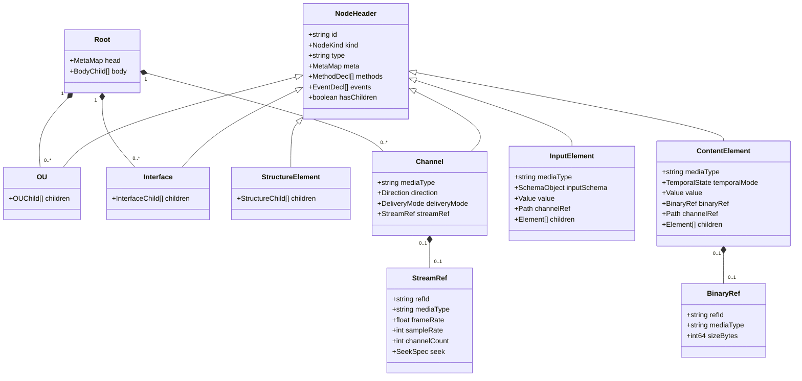

# 02 — Tree Nodes & Data Model

This document specifies the normative semantics, fields, metadata conventions, and Data-Plane references for every node in the **Agent Environment Protocol (AEP)** tree defined in [01 — Formal Grammar](./01-formal-grammar.md).

Related documents: [00 — Overview](./00-overview.md) | [01 — Formal Grammar](./01-formal-grammar.md) | [03 — Passthrough & Composition](./03-passthrough-and-composition.md) | [04 — Control & Data Planes](./04-control-and-data-planes.md) | [06 — Profiles, Sessions & Vocabularies](./06-profiles-sessions-and-vocabularies.md)

---

## 1. `Root`, `Head`, and `Body`

Every AEP projection is rooted at a single `Root` object containing two distinct partitions:

- **`Head` (`Meta*`)**: Session-wide metadata describing the protocol version, server identity, negotiated capabilities, active domain vocabularies, session role/concurrency state, security mode, and clock synchronization metadata.
- **`Body` (`(OU | Interface | Channel)*`)**: The live navigable I/O tree composed of Organizational Units, Interfaces, Elements, and Channels.

### Standard Reserved `Head` Keys

`Head` is an open `Meta` map keyed by `NamespacedIdent`. Core AEP reserves the following `aep.*` keys inside `Head`:

| Key | Value Shape | Semantics |
| --- | --- | --- |
| `aep.protocolVersion` | `string` | Active negotiated protocol version (e.g., `"1.0.0-draft"`). |
| `aep.serverInfo` | `{ name, version, description? }` | Provider identity and build version. |
| `aep.capabilities` | `CapabilitiesObject` | Negotiated profile, node kinds, channel directions, delivery modes, query flags, passthrough, and Data-Plane capabilities. See [06 — Profiles, Sessions & Vocabularies](./06-profiles-sessions-and-vocabularies.md). |
| `aep.profiles` | `string[]` | Active conformance profile identifiers (e.g., `["aep-core-streaming"]`). |
| `aep.vocabularies` | `string[]` | Optional domain vocabulary namespaces projected in `Body` (e.g., `["aep.desktop", "aep.robotics"]`). |
| `aep.session` | `{ sessionId, role, policy }` | Active session role (`"controller" \| "observer"`) and concurrency policy. |
| `aep.security` | `{ mode, reserved? }` | Active security mode (`"unauthenticated"` in local/dev reservations, or transport-bound auth descriptor). |
| `aep.clock` | `{ nowMs?, monotonicMs?, epoch?, timeZone? }` | Optional server clock metadata for aligning event timestamps and `stream+seek` offsets. |

Servers MAY emit additional custom namespaced keys in `Head` (for example, `vendor.buildId`). Updates to `Head` push via `head.updated` ([04 — Control & Data Planes](./04-control-and-data-planes.md)).

---

## 2. Canonical Path Addressing (`Path`)

Every node inside `Body` is uniquely addressed by its canonical **`Path`**:

- `"/"` addresses `Body` itself (the virtual root container of all top-level nodes).
- `"/segment"` and `"/seg1/seg2/..."` address descendants by joining `NodeId` values with `"/"`.
- Each `NodeId` MUST match `[A-Za-z0-9._-]+`, MUST NOT equal `"."` or `".."`, and MUST be unique among its siblings within the same parent.

Canonical `Path` addressing replaces fixed multi-tier address objects: whether an agent inspects `/host/workstation/ide/main-window/editor` or `/robot/head/left-eye`, the addressing mechanism and RPC signatures are identical.

---

## 3. Uniform `NodeHeader` & Common Contracts

Every node in `Body` (`ou`, `interface`, `channel`, `structure`, `content`, `input`) shares a uniform `NodeHeader`:

| Field | Grammar Symbol | Required | Description |
| --- | --- | --- | --- |
| `id` | `NodeId` | Yes | Unique identifier within the parent scope (`Segment`). |
| `kind` | `NodeKind` | Yes | Discriminant: `"ou"`, `"interface"`, `"channel"`, `"structure"`, `"content"`, or `"input"`. |
| `type` | `TypeTag` | No | Open-ended `NamespacedIdent` classifying semantic role (e.g., `"desktop.window"`, `"web.iframe"`, `"robotics.camera"`). |
| `meta` | `Meta*` | No | Open key-value map (`Key -> Value`) carrying labels, spatial bounds, descriptions, capabilities, or domain data. |
| `methods` | `MethodDecl[]` | No | Server-advertised invokable methods attached directly to this node. |
| `events` | `EventDecl[]` | No | Asynchronous semantic events that this node MAY emit via `node.event`. |
| `hasChildren` | `LazyFlag` | No | When `true` on a container node, indicates unmaterialized children loadable via `node.loadChildren`. MUST NOT be `true` on `Channel`. |

### Standard Optional `Node` Metadata Keys (`aep.*`)

Core AEP keeps domain attributes out of the fixed structural schema and models them cleanly via `meta`:

| Meta Key | Value Shape | Applicability | Description |
| --- | --- | --- | --- |
| `aep.description` | `string` | Any node | Human/agent-readable description of role, constraints, or expected semantics. |
| `aep.altText` | `string` | `Content` / `Input` / `Channel` | Alternative text for visual, audio, or sensor nodes. |
| `aep.labels` | `Record<string, string \| number \| boolean>` or `{ key, value, description? }[]` | Any node | Auxiliary semantic labels for agent discovery and filtering. |
| `aep.bounds` | `{ x, y, width, height, coordSpace? }` | Spatial nodes | Optional bounding rectangle (`width >= 0`, `height >= 0`). `coordSpace` SHOULD be `"pixel"` or `"normalized"` (or a domain coordinate frame). |
| `aep.capture` | `{ binary: boolean, mediaType?: string, refId?: string, regionSupported?: boolean }` | Any visual node | Opt-in discrete snapshot capability (e.g., window or element capture) resolved via `data.getBinary` without injecting synthetic child nodes. |
| `aep.readonly` | `boolean` | `InputElement` | Indicates the input currently rejects user/agent modification. |
| `aep.disabled` | `boolean` | `Element` / `Interface` / `Channel` | Indicates the node is present in the environment but currently inactive. |

### `MethodDecl` Contract

Any node in `Body`—an `OU`, `Interface`, `Element`, or `Channel`—MAY expose invokable methods via `methods`:

| Field | Type | Required | Description |
| --- | --- | --- | --- |
| `name` | `Name` (`NamespacedIdent`) | Yes | Method name invoked via `node.invoke`. |
| `description` | `string` | No | Natural-language summary of behavior and parameters. |
| `inputSchema` | `SchemaObject` | No | Structured parameter schema (e.g., JSON Schema). |
| `outputSchema` | `SchemaObject` | No | Structured result schema. |
| `mode` | `"request-response" \| "notification"` | No | Invocation pattern (defaults to `"request-response"`). |
| `sideEffects` | `"none" \| "read" \| "write"` | Recommended | Effect classification used by `observer` session enforcement and coordinators. Unannotated methods MUST default to `"write"`. |
| `meta` | `Meta*` | No | Optional method-level annotations. |

### `EventDecl` Contract

Nodes MAY declare asynchronous event descriptors via `events`:

| Field | Type | Required | Description |
| --- | --- | --- | --- |
| `name` | `Name` (`NamespacedIdent`) | Yes | Event identifier emitted in `node.event` notifications. |
| `description` | `string` | No | Description of when the event fires and its intent. |
| `payloadSchema` | `SchemaObject` | No | Structured schema for the notification `data` field. |
| `meta` | `Meta*` | No | Optional event-level annotations. |

---

## 4. Node Kinds in `Body`

### 4.1 Organizational Unit (`OU`, `kind = "ou"`)

An **`OU`** is a recursive structural and organizational container holding zero or more `OU`, `Interface`, or `Channel` children (`OUChild ::= OU | Interface | Channel`).

- **Purpose**: Groups subsystems, hosts, operating environments, apps, services, physical robot limbs, cloud sandboxes, or passthrough mount points without imposing fixed tier names.
- **Methods & Channels**: An `OU` can carry methods (e.g., `spawn`, `launch`, `reboot`, `estop`) and direct `Channel` attachments (e.g., system audio, joint telemetry, or stdout logs).
- **Nesting**: `OU`s nest arbitrarily inside other `OU`s. `OU`s MUST NOT appear inside an `Interface` or `Element`.

### 4.2 Interface (`Interface`, `kind = "interface"`)

An **`Interface`** is an interactive or declarative projection surface holding zero or more `Element`, `Interface`, or `Channel` children (`InterfaceChild ::= Element | Interface | Channel`).

- **Purpose**: Represents windows, pages, terminal views, control panels, embedded sub-applications, or diagnostic HUDs.
- **Arbitrary Nesting**: An `Interface` MAY directly nest child `Interface`s, and MAY also be slotted inside a `StructureElement` (for instance, an embedded browser `iframe` inside a `panel`, or an integrated terminal inside an IDE `tab`).
- **Inline Channels**: An `Interface` MAY directly attach `Channel` nodes (such as a live viewport stream or voice chat channel scoped to that surface).

### 4.3 Elements (`Element`: `structure` | `content` | `input`)

Elements live inside an `Interface` (or recursively inside parent `Element`s) and carry one of three mutually exclusive `kind` values:

1. **`StructureElement` (`kind = "structure"`)**
   - Organizes semantic layout, hierarchy, tables, lists, documents, or slotted sub-interfaces (`StructureChild ::= Element | Interface`).
   - Semantic role is expressed via open `TypeTag` (e.g., `"desktop.window"`, `"desktop.table"`, `"web.section"`, `"robotics.statusGrid"`) rather than a closed enum.
   - Structural elements MAY expose domain query methods (such as `table.query` on large tables) and opt-in `aep.capture` snapshots.

2. **`ContentElement` (`kind = "content"`)**
   - Presents static or dynamic consumable information (`ContentSpec`) and zero or more optional child `Element`s (e.g., inline annotations, badges, captions):
     - `mediaType` (`MediaType`): MIME or domain media type (e.g., `"text/plain"`, `"text/markdown"`, `"image/png"`, `"application/json"`).
     - `temporalMode` (`"static" | "dynamic"`): `"static"` for immutable point-in-time values; `"dynamic"` for values updated over time via `node.updated`.
     - Optional payload binding (at most one of):
       - `value` (`InlineValue`): Inline structured data or text.
       - `binaryRef` (`BinaryRef`): Reference to a discrete binary blob resolved on the Data Plane.
       - `channelRef` (`ChannelRef`): `Path` referencing a `Channel` node when the content displays or controls a continuous stream.

3. **`InputElement` (`kind = "input"`)**
   - Represents an agent-readable and agent-modifiable control (`InputSpec`) plus zero or more optional child `Element`s (e.g., option items, validation messages):
     - `mediaType` (`MediaType`): Expected input value media type.
     - `inputSchema` (`SchemaObject`, optional): Constraints on acceptable values (ranges, enums, patterns).
     - `value` (`InlineValue`, optional): Current readable state of the input control so agents do not need separate read methods just to inspect current field values.
     - `channelRef` (`ChannelRef`, optional): `Path` referencing an associated `act` or `duplex` `Channel` for continuous input controls (such as live audio dictation or continuous joystick streaming).
   - State mutations on `InputElement` execute server-side via attached `MethodDecl`s (such as `setValue`, `submit`, `click`, `toggle`) invoked with `node.invoke`.

### 4.4 I/O Channel (`Channel`, `kind = "channel"`)

A **`Channel`** is a strict leaf node representing a continuous or time-series I/O endpoint (`ChannelSpec`):

| Field | Type | Required | Description |
| --- | --- | --- | --- |
| `mediaType` | `MediaType` | Yes | MIME or domain payload type (e.g., `"video/h264"`, `"audio/opus"`, `"application/x-lidar"`, `"application/x-joints"`). |
| `direction` | `"sense" \| "act" \| "duplex"` | Yes | Agent-centric polarity: `"sense"` (environment → agent), `"act"` (agent → environment), or `"duplex"` (bidirectional closed-loop). |
| `deliveryMode` | `"stream" \| "stream+seek"` | Yes | `"stream"` for live continuous flows; `"stream+seek"` for buffered, recorded, or replayable time-series streams supporting seek/sampling. |
| `streamRef` | `StreamRef` | No | Data-Plane stream descriptor opened via `channel.open` or sampled via `channel.sample`. |
| `meta` | `Meta*` | No | Channel-specific parameters (encoding profiles, MTU, coordinate frames, hardware rate limits). |

> **Why `Channel` Owns Streams**: Discrete `Element`s never duplicate streaming state machines. Any continuous video feed, microphone capture, depth/LiDAR stream, robot motor command loop, or seekable recording is uniformly modeled as a `Channel` (and optionally linked from a UI `Element` via `channelRef`).

---

## 5. Data-Plane References (`BinaryRef` & `StreamRef`)

Whenever a node or method response references binary payloads or continuous streams, Control-Plane structures embed lightweight handles rather than raw bytes:

- **`BinaryRef`**:
  - `refId` (`string`): Opaque provider-scoped identifier resolved via `data.getBinary`.
  - `mediaType` (`string`): MIME or domain media type.
  - `sizeBytes` (`NonNegInteger`, optional): Known byte length when bounded ahead of time.
  - `meta` (`Meta*`, optional): Extended descriptor metadata (dimensions, checksum, supported fetch parameters).
- **`StreamRef`**:
  - `refId` (`string`): Opaque provider-scoped stream identifier resolved via `channel.open` / `channel.sample`.
  - `mediaType` (`string`): Stream payload media type.
  - `frameRate` (`NonNegNumber`, optional): Nominal frames per second for visual/sensor streams.
  - `sampleRate` (`NonNegNumber`, optional): Nominal sample rate in Hz for audio or telemetry.
  - `channelCount` (`PositiveInteger`, optional): Audio or multi-axis channel count.
  - `seek` (`SeekSpec`, optional): Seekability metadata (`{ seekable, unit?, durationMs?, startOffset?, endOffset? }`) where `unit` is `"ms" | "seconds" | "frames" | "bytes" | "samples"`.
  - `meta` (`Meta*`, optional): Codec or transport negotiation hints.

---

## 6. Node & Reference Model Diagram

