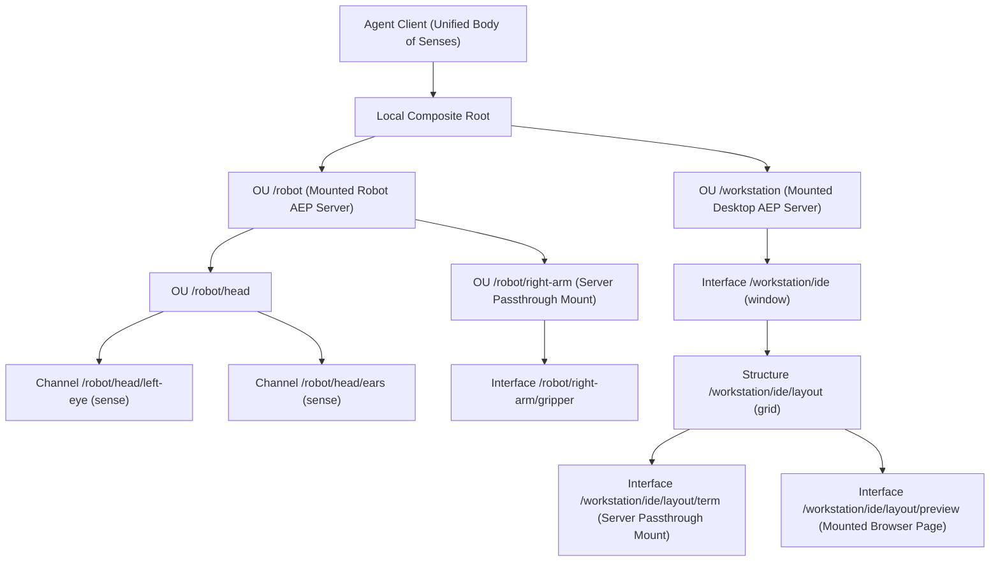
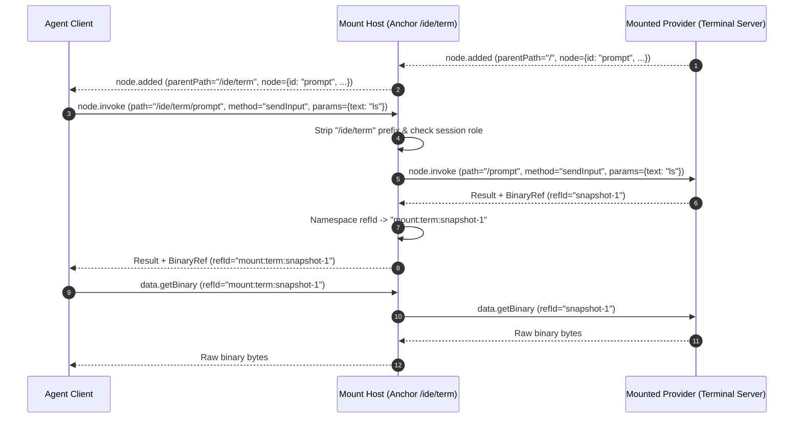

# 03 — Passthrough & Composition

Because every environment provider speaks the same recursive tree grammar, **Agent Environment Protocol (AEP)** supports **transparent AEP-to-AEP passthrough mounting** as a first-class property of the core protocol. A single client or aggregator can mount multiple independent AEP servers into one coherent **body of senses and actuation**, and any server can mount sub-applications, plugins, or hardware drivers transparently.

Related documents: [00 — Overview](./00-overview.md) | [01 — Formal Grammar](./01-formal-grammar.md) | [02 — Tree Nodes & Data Model](./02-tree-nodes.md) | [04 — Control & Data Planes](./04-control-and-data-planes.md) | [08 — Security, Authentication & Privilege Elevation](./08-security-and-elevation.md) | [09 — Configuration & Passthrough Mount Manifests](./09-configuration.md)

---

## 1. Fractal Self-Similarity

An AEP provider is self-similar at every scale:

- A physical robot arm controller can expose its own minimal AEP server (`Body` containing a `Channel` for joint commands and an `Interface` for gripper force).
- An embedded terminal or browser tab can run its own AEP server projecting an `Interface`.
- A desktop orchestrator or robot body server mounts those downstream providers inside its tree.
- An agent client mounts multiple remote servers into a single local `Root` tree.

Because the protocol boundary is identical at every hop, AEP requires **no separate app-to-server or command-routing sub-protocols**—passthrough mounting handles both local and distributed composition uniformly.

---

## 2. Composition Topologies

AEP supports four standard composition topologies:

1. **Server-Side Passthrough Mounting**:
   - A parent AEP server acts as an AEP client to one or more downstream AEP providers and mounts each provider's `Body` (or an addressed subtree path) onto an anchor `Path` inside the parent tree.
   - Upstream agent clients see one unified tree and do not need direct network reachability to downstream providers.
2. **Client-Side Multi-Root Assembly ("Body of Senses")**:
   - A single AEP client opens independent connections to multiple AEP servers (for example, a workstation AEP server, a cloud terminal AEP server, and a robotic sensor/actuator AEP server) and mounts each under a distinct local `OU` in its internal composite tree.
   - To the reasoning agent, eyes, ears, limbs, terminals, and browser windows all live in one consistent `Path` namespace.
3. **Multi-Hop Federation**:
   - Passthrough relays MAY mount other passthrough relays to arbitrary depth, subject to strict cycle prevention and capability enforcement.
4. **Many-to-Many Load-Balanced Gateways & Distributed Cloud Environments**:
   - Complex distributed environments (such as a multi-region cloud console or fleet orchestrator) MAY terminate upstream client connections across a pool of stateless or replicated AEP gateways while multiplexing downstream mounts across elastic pools of backend AEP providers.
   - Upstream clients interact with one unified virtual AEP tree even as backend shards, handlers, or gateway replicas scale, relocate, or fail over transparently.

---

## 3. Grammar Containment at Mount Points

Mounting MUST preserve the normative containment rules defined in [01 — Formal Grammar](./01-formal-grammar.md):

| Mounted Downstream Root | Valid Parent Anchor Kinds | Notes |
| --- | --- | --- |
| `Body` (`(OU \| Interface \| Api \| Channel)*`) | `Body` (`/`), `OU` | Preserves arbitrary `OU`, `Interface`, `Api`, and `Channel` top-level nodes cleanly. |
| `Body` containing only `Interface \| Channel` | `Body` (`/`), `OU`, `Interface`, `ComponentElement` | Allowed at an `Interface` or `ComponentElement` anchor ONLY if the mounted `Body` projects zero `OU` and zero `Api` children. |
| `Body` containing only `Endpoint \| Api \| Channel` | `Body` (`/`), `OU`, `Api` | Allowed at an `Api` anchor ONLY if the mounted `Body` projects zero `OU`, `Interface`, or `Element` children. |
| Single `OU` | `Body` (`/`), `OU` | `OU`s MUST NOT mount inside `Interface`, `Api`, `Endpoint`, or `Element`. |
| Single `Interface` | `Body` (`/`), `OU`, `Interface`, `StructureElement`, `ComponentElement`, `DocumentElement` | Enables mounting embedded apps, terminals, dialogs, or browser pages directly inside layout, component, or document slots. |
| Single `Api` | `Body` (`/`), `OU`, `Api` | Enables mounting headless programmatic services, toolsets, or sub-APIs inside `Body`, `OU`, or parent `Api` containers. |
| Single `Endpoint` | `Api`, `Endpoint` | Enables mounting individual API routes, resource hierarchies, or operations inside an `Api` or parent `Endpoint`. |
| Single `Element` | `Interface`, `StructureElement`, `ComponentElement`, `DocumentElement` | Enables mounting remote `ComponentElement`s, `DocumentElement`s, or primitive subtrees directly inside a surface or element container. |
| Single `Channel` | `Body` (`/`), `OU`, `Interface`, `Api`, `Endpoint`, `ComponentElement` | Enables mounting a standalone hardware sensor, actuator, or structured event stream channel under an `OU`, `Interface`, `Api`, `Endpoint`, or composite `ComponentElement`. |

Mount registrations that violate containment rules MUST be rejected with `INVALID_MESSAGE` (or `UNSUPPORTED_CAPABILITY` if passthrough or the projected node kinds are disabled).

---

## 4. Normative Transparency & Routing Rules

### 4.1 Path Rewriting

Let a downstream provider $P$ (or its subtree rooted at $S_P$) be mounted transparently at parent anchor path $A$ (for example, `/robot/right-arm` or `/ide/panel-main/term-slot`):

1. **Inbound Requests**:
   - When an upstream caller invokes `tree.get`, `tree.query`, `node.get`, `node.loadChildren`, `node.invoke`, `data.render`, `channel.open`, or `channel.sample` targeting path $A$ or a descendant $A + R$:
   - The mount host strips prefix $A$, resolves the request relative to $S_P$ on $P$ (mapping $A \to S_P$, or $A \to \text{"/"}$ when mounting $P$'s `Body`), and forwards the rewritten call to $P$.
   - When an inbound request specifies `uid` (with `followMoves !== false`) and resolves to a mounted node, the mount host maps the isolated upstream `uid` back to $P$'s local `uid` and rewrites any returned `resolvedPath` by prepending $A$. If $P$ returns `NODE_MOVED` (`error.data: { fromPath, toPath, uid? }`), the mount host MUST rewrite both `fromPath` and `toPath` by prepending $A$ (or map to a cross-mount destination when relocated at the gateway tier).
   - When forwarding `data.render` with `annotatePaths = true`, the mount host MUST rewrite every path value in the returned `pathMap` by prepending $A$ so visual markers map back to canonical upstream `Path`s.
   - For `tree.query({ rootPath })` spanning a parent subtree that contains mount points, the mount host queries both its local tree and mounted providers under `rootPath`, merging matches sorted/bounded consistently and prepending $A$ to every match's `path`.
2. **Outbound Notifications**:
   - When $P$ emits `node.added`, `node.updated`, `node.removed`, `node.moved`, or `node.event`, the mount host MUST prepend $A$ to `path`, `parentPath`, `fromPath`, and `toPath` (and map any `uid` into the mount's namespace) before forwarding upstream.
   - Only notifications falling under the mounted subtree $S_P$ are forwarded upstream when mounting a subtree rather than $P$'s entire `Body`.
3. **Internal Reference Rewriting (`state.channelRef`)**:
   - If a mounted `ViewElement`, `EditableElement`, or `ComponentElement` carries a `state.channelRef` pointing to path $C$ within $P$'s mounted subtree (including a `Channel` owned by a mounted `ComponentElement`), the mount host MUST rewrite `state.channelRef` to $A + C$ when projecting upstream so the client can open or inspect the referenced `Channel` directly.

### 4.2 Data-Plane & Identity Reference Isolation (`refId` and `uid` Mapping)

Independent downstream providers MAY emit identical `refId` values (such as `"screen"`, `"cam-0"`, or `"frame-1"`) or identical `uid` strings (such as `"root-service"` or `"item-1"`). Therefore:

- A mount host MUST isolate downstream `BinaryRef.refId`, `StreamRef.refId`, and `NodeHeader.uid` handles across mounted providers—either by issuing upstream-unique mapped handles or by applying a reversible mount namespace prefix—so two providers never collide in the upstream tree or Data Plane.
- The mount host MUST apply this mapping consistently across `NodeHeader.uid`, `state.binaryRef`, `ChannelSpec.streamRef`, `properties.capture.refId`, `node.invoke` results returning Data-Plane references, `node.moved` notifications, and Data-Plane stream notifications (`channel.chunk`, `channel.closed`).
- Upon receiving `data.getBinary`, `channel.open`, `channel.sample`, or a `uid`-targeted Control-Plane RPC with an isolated handle, the mount host resolves the owning provider, restores $P$'s local `refId` or `uid`, and forwards the operation.

### 4.3 `Head` Reconciliation & Capability Boundaries

Mounting is transparent at the tree level while remaining strictly governed by the upstream session's negotiated capabilities:

- **Capability Enforcement**: A mount host MUST validate downstream nodes and capabilities against the upstream session's active `aep.capabilities` ([06 — Profiles, Sessions & Vocabularies](./06-profiles-sessions-and-vocabularies.md)). If a downstream provider requires a disabled capability (such as projecting `Channel` nodes into an `aep-core-static` session), the mount host MUST reject the mount or block out-of-scope nodes/calls with `UNSUPPORTED_CAPABILITY`.
- **Metadata Merging**: Compatible downstream `aep.vocabularies` MAY be merged into the upstream `Head`. Provider identity and mount health metadata MAY be attached to the mount anchor node's `meta` under `aep.mount` (for example, `{ providerId, status, serverInfo }`) without altering canonical path transparency.

### 4.4 Session Role, Credential Propagation & Elevation Boundaries

- **Session Role Clamping**: If the upstream client session has `role = "observer"`, the mount host MUST enforce read-only access across all mounted subtrees—even if the mount host's internal downstream connection holds `role = "controller"`:
  - `node.invoke` targeting a mounted node whose method has `sideEffects: "write"` (or omitted `sideEffects`) MUST fail locally at the mount host with `READ_ONLY_SESSION` before reaching $P$.
  - `channel.open` on `act` channels or `channel.send` on `act`/`duplex` channels targeting mounted providers MUST fail with `READ_ONLY_SESSION`.
- **Credential Propagation (`authPropagation`)**: A mount host MUST NOT implicitly forward upstream client credentials to downstream providers. Downstream authentication follows the configured `authPropagation.strategy` (`"none"`, `"static"`, `"token-exchange"`, or `"passthrough"`) as specified in [08 — Security, Authentication & Privilege Elevation](./08-security-and-elevation.md#6-passthrough-security-credential-propagation--mount-isolation) and [09 — Configuration & Passthrough Mount Manifests](./09-configuration.md#34-mounts-section).
- **Elevation Isolation (`allowElevation`)**: Upstream `session.elevate` grants MUST NOT cross mount boundaries unless `allowElevation = true` is explicitly enabled on the mount and properly bound/verified on the downstream provider.

### 4.5 Lifecycle, Lazy Loading & Fault Isolation

- **Dynamic Attach/Detach**: When a mount attaches to or detaches from a live tree, the mount host emits `node.added` or `node.removed` at anchor path $A$.
- **Lazy Mounts**: A mount host MAY advertise `hasChildren = true` on a mount anchor and hydrate or query the downstream provider lazily when `node.loadChildren` is called.
- **Fault Isolation**: If a downstream provider disconnects, crashes, or exceeds its deadline, operations targeting $A$ or its descendants MUST fail with `MOUNT_UNAVAILABLE` or `MOUNT_TIMEOUT` without destabilizing the mount host or sibling subtrees.
- **Cycle Prevention**: Mount hosts SHOULD propagate a lightweight visited-mount origin set or hop trace during mount negotiation and MUST reject cyclic mount graphs with `MOUNT_CYCLE`.

### 4.6 Distributed Load Balancing, Replica Failover & Handler Migration

When AEP operates behind L4/L7 load balancers or spans distributed cloud gateways serving many-to-many agents and backend workers, compliant gateways and mount hosts MUST satisfy four resilience invariants:

1. **Cluster-Routable Handles**: Multi-replica gateways MUST encode or replicate `sessionId`, `resumeToken`, `subscriptionId`, `BinaryRef.refId`, `StreamRef.refId`, `grantId`, `leaseId`, and isolated `uid` values in a cluster-routable form (via signed routing tokens or shared state) rather than process-local memory pointers.
2. **Downstream Connection Pools & Replica Failover**: Mount connections MAY target multiple backend endpoints (`uris` with `loadBalancing.strategy` in [09 — Configuration](./09-configuration.md#33-connections-section)). If a downstream backend replica fails over or rebalances a shard, the mount host SHOULD reconcile differences via minimal delta notifications (`node.moved`, `node.updated`, `node.added`, `node.removed`) without tearing down the upstream client session.
3. **Stream Survival & Replay (`seq` + `session.resume`)**: Open `subscriptionId` streams MUST survive `node.moved` path relocations and SHOULD survive transparent gateway/backend replica swaps via `session.resume` ([04 — Control & Data Planes](./04-control-and-data-planes.md#sessionresume)), replaying missed buffered chunks from `lastSequence` or signaling `status = "resync_required"` / `channel.closed` for only the affected stream rather than dropping the entire session.
4. **Many-to-Many Handler Decoupling**: Both backend providers and client-side multi-agent harnesses (such as fast System 1 reflex workers and slower System 2 planners) MAY dynamically reassign which worker handles a `subscriptionId`, `node.event` stream, or `Endpoint` method invocation without altering the canonical wire contract.

---

## 5. Composition & Routing Diagrams

### Multi-Root Client Assembly & Server-Side Mounts

### Transparent Path & Reference Rewriting Sequence

