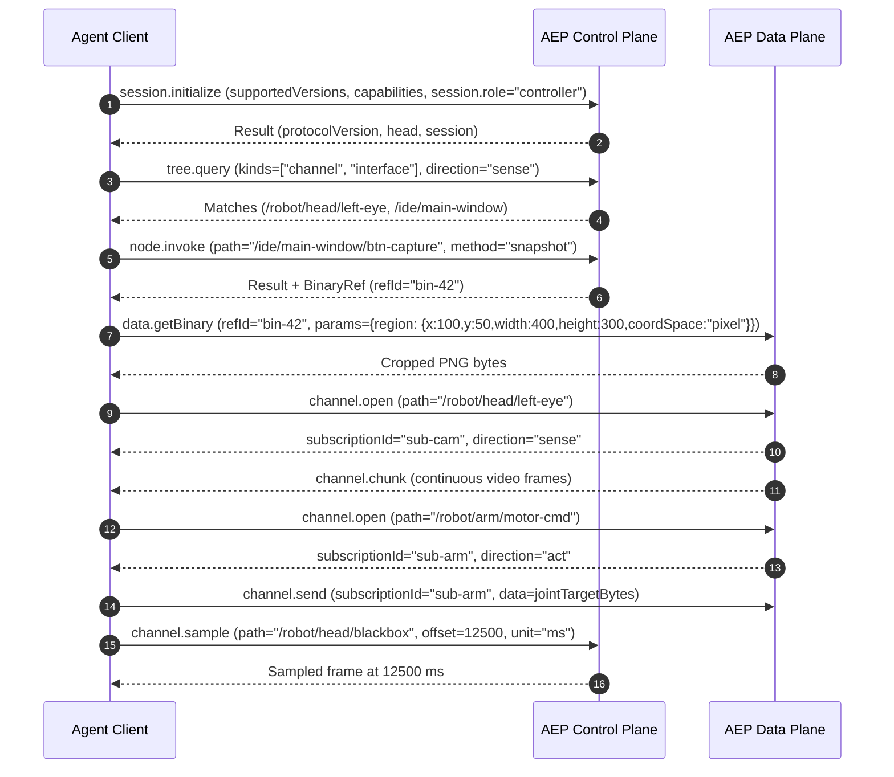

# 04 — Control & Data Planes

AEP operates over a **continuous, event-driven, bidirectional session** split logically into a **Control Plane** (tree discovery, state sync, methods, events, and lightweight references) and a **Data Plane** (discrete binary reads and continuous or seekable `Channel` I/O streams).

Related documents: [00 — Overview](./00-overview.md) | [01 — Formal Grammar](./01-formal-grammar.md) | [02 — Tree Nodes & Data Model](./02-tree-nodes.md) | [03 — Passthrough & Composition](./03-passthrough-and-composition.md) | [05 — Transport & Interoperability](./05-transport-and-interop.md) | [06 — Profiles, Sessions & Vocabularies](./06-profiles-sessions-and-vocabularies.md)

---

## 1. Control-Plane Wire Envelope

All Control-Plane messages map losslessly to one of four logical envelope variants (serialized in Protocol Buffers or JSON as negotiated at the transport boundary):

| Envelope Variant | Required Fields | Optional Fields | Purpose |
| --- | --- | --- | --- |
| **Request** | `protocolVersion`, `kind: "request"`, `id`, `method` | `params` | Invokes a Control-Plane or Data-Plane control RPC. |
| **SuccessResponse** | `protocolVersion`, `kind: "response"`, `id`, `ok: true`, `result` | — | Returns the result correlated to `Request.id`. |
| **ErrorResponse** | `protocolVersion`, `kind: "response"`, `id`, `ok: false`, `error` | — | Reports structured failure `{ code, message, data? }` correlated to `Request.id`. |
| **Notification** | `protocolVersion`, `kind: "notification"`, `method` | `params` | One-way asynchronous event or stream frame requiring no response. |

Peers MUST correlate responses by `id` and preserve causal ordering of Control-Plane mutations and notifications within a session.

---

## 2. Session Lifecycle

### `session.initialize`
MUST be the first Control-Plane request on a new session. Any other Control-Plane method invoked prior to successful initialization MUST fail with `NOT_INITIALIZED`.

- **Params**:
  - `clientInfo`: `{ name, version }`
  - `supportedVersions`: `string[]` (ordered list of supported AEP protocol versions)
  - `capabilities`: `CapabilitiesObject` (client-requested profile and capabilities; see [06 — Profiles, Sessions & Vocabularies](./06-profiles-sessions-and-vocabularies.md))
  - `security`: `{ mode, ... }` (optional; e.g., `{ mode: "unauthenticated", reserved: true }` for local/dev mode)
  - `session`: `{ role?: "controller" | "observer", allowDowngradeToObserver?: boolean }` (optional; defaults to `"controller"`)
- **Result**:
  - `protocolVersion`: `string` (selected common version, else `UNSUPPORTED_VERSION`)
  - `serverInfo`: `{ name, version }`
  - `head`: `HeadMetaMap` (authoritative initial `Head` containing `aep.protocolVersion`, `aep.serverInfo`, `aep.capabilities`, `aep.session`, `aep.security`, and optional `aep.profiles`, `aep.vocabularies`, `aep.clock`)
  - `session`: `{ sessionId, role, policy }`
  - `security`: `{ mode, reserved? }`

### `session.close`
Gracefully terminates an active session, releasing any exclusive `controller` reservation and closing active stream subscriptions.

- **Params**: `{ reason?: string }`
- **Result**: `{ closed: true }`

---

## 3. Unified Tree & Node Methods

AEP replaces per-tier discovery APIs with five uniform Control-Plane RPCs operating on canonical `Path`s:

### `tree.get`
Retrieves the `Body` tree (or a bounded subtree) and optionally the full `Head`.

- **Params**: `{ path?: Path, maxDepth?: number, includeHead?: boolean }`
  - `path` defaults to `"/"` (`Body`).
  - `maxDepth` bounds descendant traversal depth (`0` returns only the addressed node without children).
  - `includeHead` defaults to `true`.
- **Result**: `{ head?: HeadMetaMap, node: NodeOrBodyRoot }`
  - When `path` is `"/"` (or omitted), `node` represents the virtual `Body` root (`{ path: "/", kind: "body", children: BodyChild[] }`).
  - When `path` targets a node inside `Body`, `node` is that node bounded by `maxDepth`.

### `tree.query`
Searches nodes within a subtree using composable structural, semantic, and I/O predicates without transferring entire trees.

- **Params**:
  - `rootPath?`: `Path` (defaults to `"/"`)
  - `kinds?`: `NodeKind[]` (`"ou" | "interface" | "channel" | "structure" | "content" | "input"`)
  - `types?`: `TypeTag[]` (matches `node.type`, optionally supporting trailing `.*` namespace prefix matching)
  - `meta?`: `Array<{ key: Key, value?: Value }>` (if `value` is omitted, matches existence of `key`)
  - `hasMethod?`: `Name`
  - `direction?`: `"sense" | "act" | "duplex"` (filters `Channel` nodes by polarity)
  - `mediaTypePrefix?`: `string` (matches `Channel`, `Content`, or `Input` `mediaType` prefix, e.g., `"video/"` or `"text/"`)
  - `textContains?`: `string` (case-insensitive substring match against `aep.description`, `aep.altText`, inline text values, and string metadata)
  - `maxDepth?`: `number`
  - `cursor?`: `string`
  - `limit?`: `number`
- **Result**: `{ matches: Array<{ path: Path, node: Node, depth: number }>, totalCount: number, nextCursor?: string }`

### `node.get`
Fetches a single node at `path` (bounded optionally by `maxDepth`).

- **Params**: `{ path: Path, maxDepth?: number }` (`path` MUST target a node under `"/"`; passing `"/"` fails with `INVALID_PATH`).
- **Result**: `{ path: Path, node: Node }`

### `node.loadChildren`
Materializes children of a lazy container node advertising `hasChildren = true`.

- **Params**: `{ path: Path, cursor?: string, limit?: number }`
- **Result**: `{ path: Path, children: Node[], hasMore?: boolean, nextCursor?: string }`
- **Constraints**: Targeting a `Channel` node MUST fail with `INVALID_PARAMS` because `Channel` is strictly a leaf.

### `node.invoke`
Executes a server-advertised method attached to the node at `path`.

- **Params**: `{ path: Path, method: Name, params?: unknown }`
- **Result**: `{ path: Path, method: Name, result: unknown }`
- **Normative Rules**:
  - Servers MUST verify `MethodDecl.sideEffects` before execution. Unannotated custom methods MUST default to `"write"`.
  - If the active session has `role = "observer"` and the resolved method has `sideEffects = "write"`, the server MUST reject the call with `READ_ONLY_SESSION`.

---

## 4. Unified Control-Plane Notifications

Servers push asynchronous state transitions over the Control Plane without requiring client polling:

| Notification Method | Params Shape | Semantics |
| --- | --- | --- |
| `head.updated` | `{ head: HeadMetaMap }` | Authoritative `Head` metadata updated (e.g., vocabulary/capability or clock change). |
| `node.added` | `{ parentPath: Path, node: Node, index?: number }` | New child node inserted under `parentPath` (`"/"` for top-level `Body` children). |
| `node.updated` | `{ path: Path, node: Node }` | Existing node at `path` replaced or updated in place. |
| `node.removed` | `{ path: Path }` | Node at `path` and its descendants removed from the tree. |
| `node.event` | `{ path: Path, event: Name, timestamp: string, data?: unknown }` | Asynchronous semantic event emitted by the node at `path` (e.g., focus change, threshold alert, hardware trigger). |

---

## 5. Data-Plane Operations

### 5.1 Discrete Binary Resolution (`data.getBinary`)

Resolves a `BinaryRef` (from a `ContentElement`, `aep.capture` metadata, or `node.invoke` response) with optional structured fetch parameters:

- **Params**:
  - `refId`: `string` (MUST be treated strictly as an opaque reference handle; implementations MUST NOT pack query strings, crop coordinates, or options into `refId`)
  - `params?`: `object` (structured parameters supported by the reference, such as:
    - `region?: { x: number, y: number, width: number, height: number, coordSpace?: "pixel" | "normalized" }`
    - `format?: string`
    - `maxWidth?: number`
    - `maxHeight?: number`)
- **Result**: `{ reference: BinaryRef, data: bytes | base64 }`

### 5.2 Continuous & Seekable Channel Operations (`channel.*`)

All continuous sensory (`sense`), actuation (`act`), and bidirectional (`duplex`) streams operate on `Channel` nodes through one unified set of Data-Plane operations:

1. **`channel.open`**
   - Opens or subscribes to a `Channel` stream identified by `path`, `refId`, or both.
   - **Params**: `{ path?: Path, refId?: string, params?: { maxFps?: number, sampleRate?: number, startOffset?: number, unit?: SeekUnit, region?: Region, encoding?: string } }` (at least one of `path` or `refId` MUST be supplied; if both are supplied and resolve to different channels, reject with `INVALID_PARAMS`).
   - **Result**: `{ subscriptionId: string, path?: Path, reference: StreamRef, direction: Direction }`
   - **Role Enforcement**: An `observer` session MAY open `"sense"` channels and (when permitted by the server) subscribe read-only to `"duplex"` channels, but MUST be rejected with `READ_ONLY_SESSION` if attempting to open an `"act"` channel.

2. **`channel.send`**
   - Sends an actuation or client-to-environment stream frame on an active `"act"` or `"duplex"` subscription.
   - **Params**: `{ subscriptionId: string, sequence?: number, timestamp?: string, mediaType?: string, data: bytes | base64, isFinal?: boolean }`
   - **Result**: `{ accepted: boolean, sequence?: number }`
   - **Constraints**: Calling `channel.send` on a `"sense"`-only subscription MUST fail with `DIRECTION_MISMATCH`. Calling `channel.send` from an `observer` session MUST fail with `READ_ONLY_SESSION`.

3. **`channel.seek`**
   - Repositions an active `stream+seek` subscription to a target offset.
   - **Params**: `{ subscriptionId: string, offset: number, unit?: SeekUnit }`
   - **Result**: `{ subscriptionId: string, offset: number, unit?: SeekUnit }`
   - **Constraints**: Fails with `UNSUPPORTED_CAPABILITY` if the stream does not advertise `DeliveryMode = "stream+seek"` (`seek.seekable = true`).

4. **`channel.sample`**
   - Fetches a discrete frame or sample at a specific timestamp/offset from a `stream+seek` channel without consuming the full stream linearly.
   - **Params**: `{ path?: Path, refId?: string, offset: number, unit?: SeekUnit, params?: object }`
   - **Result**: `{ reference: StreamRef, offset: number, unit?: SeekUnit, mediaType: string, timestamp?: string, data: bytes | base64 }`

5. **`channel.close`**
   - Terminates an active channel subscription.
   - **Params**: `{ subscriptionId: string }`
   - **Result**: `{ closed: boolean, subscriptionId: string }`

6. **Stream Notifications (`channel.chunk` & `channel.closed`)**
   - `channel.chunk`: `{ subscriptionId: string, refId: string, sequence: number, timestamp: string, mediaType: string, offset?: number, data: bytes | base64, isFinal?: boolean }` — pushed from environment to agent on `"sense"` and `"duplex"` subscriptions.
   - `channel.closed`: `{ subscriptionId: string, refId: string, reason?: string }` — emitted when the server closes or terminates a subscription.

> **Transport Optimization**: On multiplexed binary transports such as QUIC or WebRTC ([05 — Transport & Interoperability](./05-transport-and-interop.md)), `data.getBinary` responses and `channel.chunk` / `channel.send` payloads flow over dedicated Data-Plane streams/tracks as raw binary frames rather than base64-encoded Control-Plane JSON messages.

---

## 6. Standard Error Codes

| Error Code | Category | Meaning |
| --- | --- | --- |
| `PARSE_ERROR` | Framing | Malformed binary or JSON frame could not be decoded. |
| `INVALID_MESSAGE` | Grammar / Envelope | Envelope missing required fields or tree mutation violates formal grammar. |
| `METHOD_NOT_FOUND` | Dispatch | Unknown Control-Plane RPC or unknown method name on target node. |
| `INVALID_PARAMS` | Validation | Missing or malformed arguments, invalid `region`, or conflicting `path`/`refId`. |
| `INTERNAL_ERROR` | Server | Unexpected server or transport runtime error. |
| `NOT_INITIALIZED` | Lifecycle | Request sent before `session.initialize` completed. |
| `UNSUPPORTED_VERSION` | Lifecycle | No mutually supported `protocolVersion` during `session.initialize`. |
| `UNSUPPORTED_CAPABILITY` | Profile | Operation, `NodeKind`, `Direction`, `DeliveryMode`, or `seek` outside negotiated capabilities. |
| `UNSUPPORTED_AUTH_MODE` | Security | Unrecognized or disallowed `security.mode` during `session.initialize`. |
| `NODE_NOT_FOUND` | Addressing | Valid `Path` does not exist in `Body`. |
| `INVALID_PATH` | Addressing | Syntactically invalid `Path` or disallowed root `"/"` target (e.g., on `node.get`). |
| `INVALID_REFERENCE` | Data Plane | Malformed `BinaryRef` / `StreamRef` or invalid `ChannelRef` target. |
| `BINARY_NOT_FOUND` | Data Plane | Referenced `BinaryRef.refId` does not exist or has expired. |
| `CHANNEL_NOT_FOUND` | Data Plane | Referenced `Channel` `path`, `StreamRef.refId`, or `subscriptionId` does not exist. |
| `DIRECTION_MISMATCH` | Data Plane | Operation incompatible with `ChannelSpec.direction` (e.g., `channel.send` on a `"sense"` channel). |
| `READ_ONLY_SESSION` | Session | `observer` attempted a `sideEffects = "write"` invocation or an `"act"`/`"duplex"` write. |
| `CONTROLLER_OCCUPIED` | Session | `single-controller` session already occupied and `allowDowngradeToObserver = false`. |
| `MOUNT_UNAVAILABLE` | Passthrough | Mounted downstream AEP provider is disconnected or unreachable. |
| `MOUNT_TIMEOUT` | Passthrough | Mounted downstream AEP provider failed to respond before deadline. |
| `MOUNT_CYCLE` | Passthrough | Cyclic passthrough mount detected across AEP hops. |

---

## 7. Control & Data Plane Sequence Diagram

