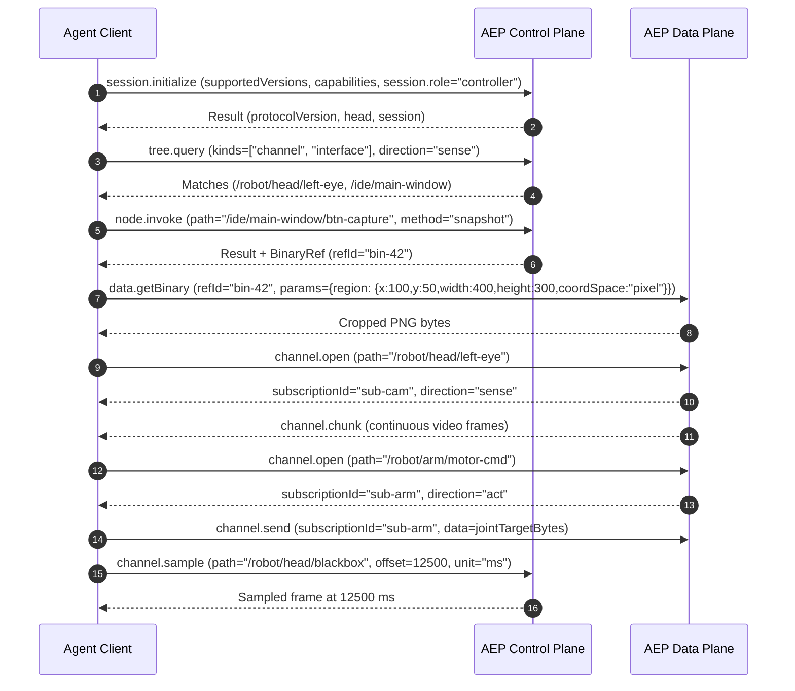

# 04 — Control & Data Planes

AEP operates over a **continuous, event-driven, bidirectional session** split logically into a **Control Plane** (tree discovery, state sync, methods, events, and lightweight references) and a **Data Plane** (discrete binary reads and continuous or seekable `Channel` I/O streams).

Related documents: [00 — Overview](./00-overview.md) | [01 — Formal Grammar](./01-formal-grammar.md) | [02 — Tree Nodes & Data Model](./02-tree-nodes.md) | [03 — Passthrough & Composition](./03-passthrough-and-composition.md) | [05 — Transport & Interoperability](./05-transport-and-interop.md) | [06 — Profiles, Sessions & Vocabularies](./06-profiles-sessions-and-vocabularies.md) | [08 — Security, Authentication & Privilege Elevation](./08-security-and-elevation.md) | [09 — Configuration & Passthrough Mount Manifests](./09-configuration.md)

---

## 1. Control-Plane Wire Envelope

All Control-Plane messages map losslessly to one of four logical envelope variants (serialized in Protocol Buffers or JSON as negotiated at the transport boundary):

| Envelope Variant | Required Fields | Optional Fields | Purpose |
| --- | --- | --- | --- |
| **Request** | `protocolVersion`, `kind: "request"`, `id`, `method` | `params` | Invokes a Control-Plane or Data-Plane control RPC. |
| **SuccessResponse** | `protocolVersion`, `kind: "response"`, `id`, `ok: true`, `result` | — | Returns the result correlated to `Request.id`. |
| **ErrorResponse** | `protocolVersion`, `kind: "response"`, `id`, `ok: false`, `error` | — | Reports structured failure `{ code, message, data? }` correlated to `Request.id`. |
| **Notification** | `protocolVersion`, `kind: "notification"`, `method` | `params`, `seq` | One-way asynchronous event or stream frame requiring no response (`seq?: NonNegInteger` provides a per-session watermark for `session.resume`). |

Peers MUST correlate responses by `id` and preserve causal ordering of Control-Plane mutations and notifications within a session.

Prior to `session.initialize` completing, `Request` envelopes carry the client's preferred version (`supportedVersions[0]`). Once `session.initialize` (or `session.resume`) selects a session `protocolVersion`, all subsequent `Request`, `Response`, and `Notification` envelopes on that session MUST carry the negotiated `protocolVersion`; peers receiving a post-handshake envelope with a mismatched `protocolVersion` MUST reject it with `UNSUPPORTED_VERSION`.

---

## 2. Session Lifecycle

### `session.initialize`
MUST be the first Control-Plane request on a new session. Any other Control-Plane method invoked prior to successful initialization MUST fail with `NOT_INITIALIZED`.

- **Params**:
  - `clientInfo`: `{ name, version }`
  - `supportedVersions`: `string[]` (non-empty ordered list of Semantic Versioning 2.0.0 AEP protocol versions in descending client preference order, e.g., `["1.0.0-beta.0"]`)
  - `capabilities`: `CapabilitiesObject` (client-requested profile and capabilities; see [06 — Profiles, Sessions & Vocabularies](./06-profiles-sessions-and-vocabularies.md))
  - `security`: `{ mode: AuthMode, token?: string, apiKey?: string, keyId?: string, reserved?: boolean }` (optional; defaults to transport-bound auth or `{ mode: "unauthenticated", reserved: true }` when permitted)
  - `session`: `{ role?: "controller" | "observer", allowDowngradeToObserver?: boolean }` (optional; defaults to `"controller"`)
- **Result**:
  - `protocolVersion`: `string` (selected common version per [06 — Profiles, Sessions & Vocabularies](./06-profiles-sessions-and-vocabularies.md#11-protocol-version-negotiation--adaptation); if no mutually supported version exists, the server MUST fail with `UNSUPPORTED_VERSION` and `error.data: { supportedVersions: string[], requestedVersions?: string[] }` listing the server's supported versions in server preference order so clients MAY adapt and retry `session.initialize`)
  - `serverInfo`: `{ name, version }`
  - `authRequired?`: `boolean` (`true` when two-step `"challenge-response"` requires `session.authenticate`)
  - `challenge?`: `{ challengeId: string, algorithm: string, nonce: string, channelBinding?: string, expiresAt: string }` (present when `authRequired = true`)
  - `head?`: `HeadMetaMap` (authoritative initial `Head`; returned once authenticated)
  - `session?`: `{ sessionId, role, policy, resumeToken? }`
  - `security`: `{ mode, principal?, sessionAuthenticated?, reserved? }`

### `session.authenticate`
Completes two-step `"challenge-response"` authentication during session startup or rotates/refreshes expiring application credentials (such as `"bearer"` JWTs) in-session without interrupting active `Channel` streams or releasing `controller` reservations ([08 — Security](./08-security-and-elevation.md#3-application-layer-authentication)).

- **Params**: `{ mode: AuthMode, challengeId?: string, signature?: string, token?: string, apiKey?: string }`
- **Result**: `{ authenticated: true, head?: HeadMetaMap, session?: { sessionId, role, policy, resumeToken? }, security: { mode, principal?, sessionAuthenticated: true, expiresAt? } }`

### `session.resume`
Re-attaches a client to an existing logical session after a transport disconnect, QUIC migration failure, or load-balancer/gateway replica failover—preserving session role, active elevation grants, subtree leases, and `Channel` subscriptions without re-running `session.initialize`.

- **Params**: `{ sessionId: string, resumeToken: string, lastControlSeq?: number, subscriptions?: Array<{ subscriptionId: string, lastSequence?: number }> }`
- **Result**: `{ resumed: true, sessionId: string, resumeToken: string, currentControlSeq: number, replayedCount: number, resyncRequired?: boolean, head?: HeadMetaMap, subscriptions: Array<{ subscriptionId: string, status: "resumed" | "resync_required" | "closed" }> }`
- **Constraints**: If `sessionId` or `resumeToken` is unknown or expired beyond the server's resumption TTL, the server MUST reject with `SESSION_EXPIRED`, signaling the client to establish a fresh session via `session.initialize`.

### `session.acquireLease`
Claims or renews a cooperative lock/lease on a subtree `path` (or `uid`) in `multi-controller` environments so concurrent agents or System 1 / System 2 harness loops do not issue conflicting mutations.

- **Params**: `{ path: Path, uid?: string, leaseId?: string, mode?: "exclusive-write" | "shared-read", durationMs?: number, holderName?: string }` (supplying an existing `leaseId` renews its TTL; `mode` defaults to `"exclusive-write"`).
- **Result**: `{ leaseId: string, path: Path, uid?: string, mode: "exclusive-write" | "shared-read", expiresAt: string }`
- **Constraints**: While an `"exclusive-write"` lease is active, competing `sideEffects: "write"` `node.invoke` calls or `channel.open` (`act`) / `channel.send` calls from other sessions targeting `path` or any descendant MUST fail with `LEASE_CONFLICT` (`error.data: { leasedPath, holderSessionId, holderName?, expiresAt }`). Read operations and `"sense"` subscriptions remain permitted.

### `session.releaseLease`
Releases an active subtree lease prior to TTL expiration.

- **Params**: `{ leaseId: string }`
- **Result**: `{ released: true, leaseId: string }`

### `session.elevate`
Requests a scoped, time-bounded, or single-use privilege elevation grant in response to an `ELEVATION_REQUIRED` challenge or proactively for a target `Path` ([08 — Security](./08-security-and-elevation.md#5-privilege-elevation--agent-elevation-instructions)).

- **Params**: `{ challengeId?: string, targetPath?: Path, scopes?: string[], level: "confirm" | "elevated" | "admin", reason: string, durationMs?: number, singleUse?: boolean, factor: { type: "human-approval" | "totp" | "passkey" | "token" | "policy-attestation", proof?: string | object, waitForApproval?: boolean } }`
- **Result**: `{ grantId: string, status: "granted" | "pending" | "denied", level: "confirm" | "elevated" | "admin", targetPath?: Path, scopes: string[], singleUse: boolean, expiresAt?: string }`

### `session.dropElevation`
Immediately revokes one specific elevation grant or all active elevation grants held by the session.

- **Params**: `{ grantId?: string }`
- **Result**: `{ dropped: string[] }`

### `session.close`
Gracefully terminates an active session, revoking active elevation grants, releasing any exclusive `controller` reservation, and closing active stream subscriptions.

- **Params**: `{ reason?: string }`
- **Result**: `{ closed: true }`

---

## 3. Unified Tree & Node Methods

AEP replaces per-tier discovery APIs with five uniform Control-Plane RPCs operating on canonical `Path`s:

### `tree.get`
Retrieves the `Body` tree (or a bounded subtree) and optionally the full `Head`.

- **Params**: `{ path?: Path, maxDepth?: number, includeHead?: boolean }`
  - `path` defaults to `"/"` (`Body`).
  - `maxDepth` bounds descendant traversal depth (`0` returns only the addressed node without children).
  - `includeHead` defaults to `true`.
- **Result**: `{ head?: HeadMetaMap, node: NodeOrBodyRoot }`
  - When `path` is `"/"` (or omitted), `node` represents the virtual `Body` root (`{ path: "/", kind: "body", children: BodyChild[] }`).
  - When `path` targets a node inside `Body`, `node` is that node bounded by `maxDepth`.

### `tree.query`
Searches nodes within a subtree using composable structural, semantic, and I/O predicates without transferring entire trees.

- **Params**:
  - `rootPath?`: `Path` (defaults to `"/"`)
  - `uids?`: `string[]` (matches `node.uid` against an explicit set of stable logical node identifiers)
  - `kinds?`: `NodeKind[]` (`"ou" | "interface" | "api" | "endpoint" | "channel" | "structure" | "component" | "document" | "view" | "editable" | "control"`)
  - `types?`: `TypeTag[]` (matches `node.type`, optionally supporting trailing `.*` namespace prefix matching)
  - `properties?`: `Array<{ key: Key, value?: Value }>` (matches declarative `node.properties`; if `value` is omitted, matches existence of `key`)
  - `state?`: `Array<{ key: Key, value?: Value }>` (matches live `node.state`, e.g., `focused: true` or `valid: false`; if `value` is omitted, matches existence of `key`)
  - `meta?`: `Array<{ key: Key, value?: Value }>` (matches auxiliary `node.meta`; if `value` is omitted, matches existence of `key`)
  - `hasMethod?`: `Name`
  - `direction?`: `"sense" | "act" | "duplex"` (filters `Channel` nodes by polarity)
  - `payloadMode?`: `"binary" | "event"` (filters `Channel` nodes by payload mode)
  - `mediaTypePrefix?`: `string` (matches `ChannelSpec.mediaType` or `properties.mediaType` prefix, e.g., `"video/"`, `"text/"`, or `"application/aep+event"`)
  - `textContains?`: `string` (case-insensitive substring match against `properties.title`, `properties.label`, `properties.description`, `properties.altText`, inline string `state.value`, and string `meta` values)
  - `maxDepth?`: `number`
  - `cursor?`: `string`
  - `limit?`: `number`
- **Result**: `{ matches: Array<{ path: Path, node: Node, depth: number }>, totalCount: number, nextCursor?: string }`

### `node.get`
Fetches a single node at `path` or `uid` (bounded optionally by `maxDepth`).

- **Params**: `{ path?: Path, uid?: string, followMoves?: boolean, maxDepth?: number, grantId?: string }` (`path` MUST target a node under `"/"`, or `uid` MUST be supplied; passing `"/"` without `uid` fails with `INVALID_PATH`; `followMoves` defaults to `true` when `uid` is supplied).
- **Result**: `{ path: Path, resolvedPath?: Path, node: Node }`

### `node.loadChildren`
Materializes children of a lazy container node advertising `hasChildren = true`.

- **Params**: `{ path?: Path, uid?: string, followMoves?: boolean, cursor?: string, limit?: number, grantId?: string }`
- **Result**: `{ path: Path, resolvedPath?: Path, children: Node[], hasMore?: boolean, nextCursor?: string }`
- **Constraints**: Targeting a `Channel` node MUST fail with `INVALID_PARAMS` because `Channel` is strictly a leaf.

### `node.invoke`
Executes a server-advertised method attached to the node at `path` (or resolved via `uid`).

- **Params**: `{ path?: Path, uid?: string, followMoves?: boolean, method: Name, params?: unknown, expectedRevision?: number, leaseId?: string, grantId?: string }`
- **Result**: `{ path: Path, resolvedPath?: Path, method: Name, revision?: number, result: unknown }`
- **Normative Rules**:
  - Servers MUST verify `MethodDecl.sideEffects` before execution. Unannotated custom methods MUST default to `"write"`.
  - If the active session has `role = "observer"` and the resolved method has `sideEffects = "write"`, the server MUST reject the call with `READ_ONLY_SESSION`.
  - If `path` was recently relocated via `node.moved` and no `uid` (or `followMoves = false`) was supplied, servers tracking move history MUST fail with `NODE_MOVED` (`error.data: { fromPath, toPath, uid? }`).
  - If `expectedRevision` is supplied and `node.revision` exists and differs, servers MUST reject mutating calls with `REVISION_CONFLICT` (`error.data: { path, expectedRevision, actualRevision }`).
  - If an `"exclusive-write"` lease covers the target path and the caller does not hold it (or passes an invalid `leaseId`), servers MUST reject `"write"` calls with `LEASE_CONFLICT`.
  - If the target node (`properties.elevation`) or `MethodDecl.elevation` requires privilege elevation and no valid matching grant (or explicit `grantId` when required) is active, the server MUST reject the call with `ELEVATION_REQUIRED` and structured challenge instructions ([08 — Security](./08-security-and-elevation.md#52-elevation-challenge-elevation_required)).
  - Standardized interactive primitive mutations execute through `node.invoke`: `ControlElement` actions use `invoke` (or domain-specific action methods), and `EditableElement` value changes use `setValue` (`params: { value }`) or `patchState` (`params: { state }`) alongside optional convenience methods (`toggle`, `replaceRange`, `clear`). Resulting changes to `state`, `properties`, or tree structure MUST propagate causally via `node.updated`, `node.added`, `node.moved`, or `node.removed`.

---

## 4. Unified Control-Plane Notifications

Servers push asynchronous state transitions over the Control Plane without requiring client polling:

| Notification Method | Params Shape | Semantics |
| --- | --- | --- |
| `head.updated` | `{ head: HeadMetaMap }` | Authoritative `Head` metadata updated (e.g., vocabulary/capability, security, or clock change). |
| `node.added` | `{ parentPath: Path, node: Node, index?: number }` | New child node inserted under `parentPath` (`"/"` for top-level `Body` children). |
| `node.updated` | `{ path: Path, node: Node }` | Existing node at `path` replaced or updated in place. |
| `node.moved` | `{ fromPath: Path, toPath: Path, uid?: string, node?: Node, index?: number }` | Existing node or subtree relocated from `fromPath` to `toPath` while preserving `uid`, active `Channel` `subscriptionId`s, and active subtree leases. |
| `node.removed` | `{ path: Path }` | Node at `path` and its descendants removed from the tree. |
| `node.event` | `{ path: Path, event: Name, timestamp: string, data?: unknown }` | Asynchronous semantic event emitted by the node at `path` (e.g., focus change, threshold alert, API callback, hardware trigger). |
| `session.authExpiring` | `{ expiresAt: string, remainingMs: number }` | Warns the client that the active application credential is nearing expiry so it can call `session.authenticate` seamlessly. |
| `session.elevationUpdated` | `{ grantId: string, challengeId?: string, status: "granted" \| "denied" \| "expired" \| "revoked", expiresAt?: string, reason?: string }` | Pushes asynchronous completion, expiration, or revocation of an elevation grant. |
| `session.leaseUpdated` | `{ leaseId: string, path: Path, uid?: string, status: "acquired" \| "released" \| "expired", holderSessionId: string, holderName?: string, expiresAt?: string }` | Broadcasts cooperative subtree lease acquisition, release, or expiration to interested sessions. |

---

## 5. Data-Plane Operations

### 5.1 Discrete Binary Resolution (`data.getBinary`)

Resolves a `BinaryRef` (from `state.binaryRef`, `properties.capture`, or a `node.invoke` response) with optional structured fetch parameters:

- **Params**:
  - `refId`: `string` (MUST be treated strictly as an opaque reference handle; implementations MUST NOT pack query strings, crop coordinates, or options into `refId`)
  - `grantId?`: `string` (optional elevation grant identifier when resolving protected binaries)
  - `params?`: `object` (structured parameters supported by the reference, such as:
    - `region?: { x: number, y: number, width: number, height: number, coordSpace?: "pixel" | "normalized" }`
    - `format?: string`
    - `maxWidth?: number`
    - `maxHeight?: number`
    - `mode?: "renderMinimal" | "renderExpress" | "renderFull"`
    - `annotatePaths?: boolean`)
- **Result**: `{ reference: BinaryRef, data: bytes | base64, pathMap?: Record<string, Path> }`

### 5.2 Multi-Tier Surface & Subtree Rendering (`data.render`)

Renders a visual `Interface` or `Element` node (and its visible descendants) at a requested fidelity tier (`"renderMinimal"`, `"renderExpress"`, or `"renderFull"`) as defined in [02 — Tree Nodes & Data Model](./02-tree-nodes.md#6-multi-tier-surface-rendering-renderminimal-renderexpress-renderfull):

- **Params**:
  - `path?`: `Path` (MUST address an `Interface` or `Element` node; targeting `OU`, `Api`, `Endpoint`, or `Channel` MUST fail with `INVALID_PARAMS`)
  - `uid?`: `string` (optional logical node identifier; `followMoves?: boolean` defaults to `true`)
  - `mode`: `"renderMinimal" | "renderExpress" | "renderFull"`
  - `grantId?`: `string`
  - `params?`: `{ format?: string, region?: Region, maxWidth?: number, maxHeight?: number, annotatePaths?: boolean, maxDepth?: number }`
- **Result**:
  - `path`: `Path`
  - `resolvedPath?`: `Path`
  - `mode`: `"renderMinimal" | "renderExpress" | "renderFull"`
  - `mediaType`: `MediaType` (e.g., `"image/svg+xml"`, `"image/png"`, `"text/x-aep-layout"`)
  - `reference?`: `BinaryRef`
  - `data`: `bytes | base64 | string`
  - `pathMap?`: `Record<string, Path>` (present when `annotatePaths = true`, mapping visual callout labels such as `"#1"` to canonical AEP `Path`s)
- **Constraints**: If the server does not support the requested `mode` in `Head["aep.capabilities"].rendering.serverModes`, it MUST reject with `UNSUPPORTED_CAPABILITY` (clients MAY still synthesize `"renderMinimal"` locally from the Control-Plane tree).

### 5.3 Continuous, Seekable & Event-Stream Channel Operations (`channel.*`)

All continuous sensory (`sense`), actuation (`act`), and bidirectional (`duplex`) streams—whether `"binary"` or structured `"event"` streams—operate on `Channel` nodes through one unified set of Data-Plane operations. Once opened, active `subscriptionId` streams MUST survive `node.moved` path relocations and SHOULD survive transparent gateway/backend replica swaps via `session.resume`:

1. **`channel.open`**
   - Opens or subscribes to a `Channel` stream identified by `path`, `uid`, `refId`, or a combination thereof.
   - **Params**: `{ path?: Path, uid?: string, followMoves?: boolean, refId?: string, leaseId?: string, grantId?: string, params?: { maxFps?: number, sampleRate?: number, startOffset?: number, unit?: SeekUnit, region?: Region, encoding?: string, eventFilter?: { names?: Name[] } } }` (at least one of `path`, `uid`, or `refId` MUST be supplied; if multiple are supplied and resolve to different channels, reject with `INVALID_PARAMS`).
   - **Result**: `{ subscriptionId: string, path?: Path, resolvedPath?: Path, reference: StreamRef, direction: Direction, payloadMode: "binary" | "event" }`
   - **Role & Lease Enforcement**: An `observer` session MAY open `"sense"` channels and (when permitted by the server) subscribe read-only to `"duplex"` channels, but MUST be rejected with `READ_ONLY_SESSION` if attempting to open an `"act"` channel. Attempting to open an `"act"` channel under another session's `"exclusive-write"` lease fails with `LEASE_CONFLICT`.

2. **`channel.send`**
   - Sends an actuation or client-to-environment frame on an active `"act"` or `"duplex"` subscription.
   - **Params**: `{ subscriptionId: string, leaseId?: string, sequence?: number, timestamp?: string, mediaType?: string, data?: bytes | base64, event?: ChannelEvent, isFinal?: boolean }`
   - **Result**: `{ accepted: boolean, sequence?: number }`
   - **Constraints**:
     - Calling `channel.send` on a `"sense"`-only subscription MUST fail with `DIRECTION_MISMATCH`.
     - Calling `channel.send` from an `observer` session MUST fail with `READ_ONLY_SESSION`.
     - Calling `channel.send` on a channel locked by another session's `"exclusive-write"` lease MUST fail with `LEASE_CONFLICT`.
     - On `"binary"` channels, `data` MUST be provided and `event` MUST NOT be set; on `"event"` channels, `event` (`{ name?, id?, payload, headers? }`) MUST be provided and `data` MUST NOT be set. Violations MUST fail with `PAYLOAD_MODE_MISMATCH`.

3. **`channel.seek`**
   - Repositions an active `stream+seek` subscription to a target offset.
   - **Params**: `{ subscriptionId: string, offset: number, unit?: SeekUnit }` (`SeekUnit` includes `"ms" | "seconds" | "frames" | "bytes" | "samples" | "events"`).
   - **Result**: `{ subscriptionId: string, offset: number, unit?: SeekUnit }`
   - **Constraints**: Fails with `UNSUPPORTED_CAPABILITY` if the stream does not advertise `DeliveryMode = "stream+seek"` (`seek.seekable = true`).

4. **`channel.sample`**
   - Fetches a discrete frame, sample, or event at a specific timestamp/offset from a `stream+seek` channel without consuming the full stream linearly.
   - **Params**: `{ path?: Path, uid?: string, followMoves?: boolean, refId?: string, offset: number, unit?: SeekUnit, grantId?: string, params?: object }`
   - **Result**: `{ reference: StreamRef, resolvedPath?: Path, offset: number, unit?: SeekUnit, mediaType: string, timestamp?: string, data?: bytes | base64, event?: ChannelEvent }` (`data` for `payloadMode = "binary"`, `event` for `payloadMode = "event"`).

5. **`channel.close`**
   - Terminates an active channel subscription.
   - **Params**: `{ subscriptionId: string }`
   - **Result**: `{ closed: boolean, subscriptionId: string }`

6. **Stream Notifications (`channel.chunk` & `channel.closed`)**
   - `channel.chunk`: `{ subscriptionId: string, refId: string, sequence: number, timestamp: string, mediaType: string, offset?: number, data?: bytes | base64, event?: ChannelEvent, isFinal?: boolean }` — pushed from environment to agent on `"sense"` and `"duplex"` subscriptions (`data` exclusively on `"binary"` channels; `event` exclusively on `"event"` channels).
   - `channel.closed`: `{ subscriptionId: string, refId: string, reason?: string }` — emitted when the server closes or terminates a subscription.

> **Transport Optimization**: On multiplexed binary transports such as QUIC or WebRTC ([05 — Transport & Interoperability](./05-transport-and-interop.md)), `data.getBinary`, `data.render`, and `"binary"` `channel.chunk` / `channel.send` payloads flow over dedicated Data-Plane streams/tracks as raw binary frames rather than base64-encoded Control-Plane JSON messages. `"event"` channel frames serialize `ChannelEvent` directly as typed Protobuf or JSON objects without wrapping events inside opaque byte blobs.

---

## 6. Standard Error Codes

| Error Code | Category | Meaning |
| --- | --- | --- |
| `PARSE_ERROR` | Framing | Malformed binary or JSON frame could not be decoded. |
| `INVALID_MESSAGE` | Grammar / Envelope | Envelope missing required fields or tree mutation violates formal grammar. |
| `METHOD_NOT_FOUND` | Dispatch | Unknown Control-Plane RPC or unknown method name on target node. |
| `INVALID_PARAMS` | Validation | Missing or malformed arguments, invalid `region`, non-visual target on `data.render`, or conflicting `path`/`refId`. |
| `INTERNAL_ERROR` | Server | Unexpected server or transport runtime error. |
| `NOT_INITIALIZED` | Lifecycle | Request sent before `session.initialize` completed. |
| `SESSION_EXPIRED` | Lifecycle | `sessionId` or `resumeToken` in `session.resume` is invalid or expired; client must re-initialize. |
| `UNSUPPORTED_VERSION` | Lifecycle | No mutually supported `protocolVersion` during `session.initialize` (`error.data: { supportedVersions }`), or post-handshake envelope `protocolVersion` mismatch. |
| `UNSUPPORTED_CAPABILITY` | Profile | Operation, `NodeKind`, `Direction`, `DeliveryMode`, `PayloadMode`, `RenderMode`, or `seek` outside negotiated capabilities. |
| `UNSUPPORTED_AUTH_MODE` | Security | Unrecognized or disallowed `security.mode` during `session.initialize` or `session.authenticate`. |
| `AUTHENTICATION_REQUIRED` | Security | Unauthenticated session attempted a protected operation or pending `"challenge-response"` auth was not completed. |
| `AUTHENTICATION_FAILED` | Security | Invalid token, API key, certificate, or cryptographic challenge signature. |
| `TOKEN_EXPIRED` | Security | Active application credential expired; client MUST refresh via `session.authenticate`. |
| `INSECURE_TRANSPORT` | Security | Secret credentials or non-loopback session attempted over an unencrypted network transport. |
| `ACCESS_DENIED` | Security | Authenticated principal lacks required authorization scope for the requested node, method, or channel. |
| `ELEVATION_REQUIRED` | Security | Operation requires step-up privilege elevation; `error.data` returns structured challenge and `instructions`. |
| `ELEVATION_DENIED` | Security | Elevation request rejected by policy, invalid factor, or human operator denial. |
| `ELEVATION_EXPIRED` | Security | Referenced `grantId` has expired, been consumed (`singleUse`), or been revoked. |
| `NODE_NOT_FOUND` | Addressing | Valid `Path` (or `uid`) does not exist in `Body`. |
| `NODE_MOVED` | Addressing | Node or subtree relocated (`error.data: { fromPath, toPath, uid? }`). |
| `INVALID_PATH` | Addressing | Syntactically invalid `Path` or disallowed root `"/"` target (e.g., on `node.get`). |
| `INVALID_REFERENCE` | Data Plane | Malformed `BinaryRef` / `StreamRef` or invalid `state.channelRef` target. |
| `BINARY_NOT_FOUND` | Data Plane | Referenced `BinaryRef.refId` does not exist or has expired. |
| `CHANNEL_NOT_FOUND` | Data Plane | Referenced `Channel` `path`, `StreamRef.refId`, or `subscriptionId` does not exist. |
| `DIRECTION_MISMATCH` | Data Plane | Operation incompatible with `ChannelSpec.direction` (e.g., `channel.send` on a `"sense"` channel). |
| `PAYLOAD_MODE_MISMATCH` | Data Plane | Frame payload mismatched `ChannelSpec.payloadMode` (e.g., `data` supplied on an `"event"` channel or `event` on a `"binary"` channel). |
| `READ_ONLY_SESSION` | Session | `observer` attempted a `sideEffects = "write"` invocation or an `"act"`/`"duplex"` write. |
| `CONTROLLER_OCCUPIED` | Session | `single-controller` session already occupied and `allowDowngradeToObserver = false`. |
| `REVISION_CONFLICT` | Concurrency | `node.invoke` `expectedRevision` did not match current `node.revision`. |
| `LEASE_CONFLICT` | Concurrency | Mutating operation blocked by another session's active `"exclusive-write"` subtree lease. |
| `MOUNT_UNAVAILABLE` | Passthrough | Mounted downstream AEP provider is disconnected or unreachable. |
| `MOUNT_TIMEOUT` | Passthrough | Mounted downstream AEP provider failed to respond before deadline. |
| `MOUNT_CYCLE` | Passthrough | Cyclic passthrough mount detected across AEP hops. |

---

## 7. Control & Data Plane Sequence Diagram

