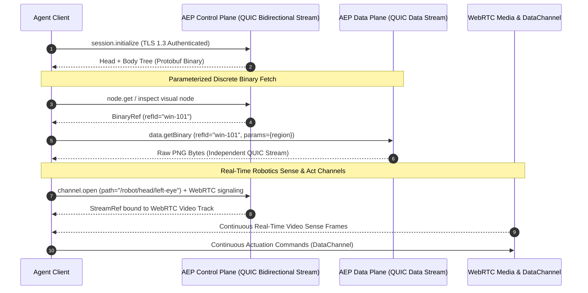

# 05 — Transport & Interoperability

AEP strictly governs the **Control Plane** and **Data Plane** while delegating low-level transport framing, encryption, congestion control, peer authentication, and media packetization to external transport protocols.

Related documents: [00 — Overview](./00-overview.md) | [01 — Formal Grammar](./01-formal-grammar.md) | [04 — Control & Data Planes](./04-control-and-data-planes.md) | [06 — Profiles, Sessions & Vocabularies](./06-profiles-sessions-and-vocabularies.md)

---

## 1. Delegated Transport Requirements

Any transport binding carrying an AEP session MUST satisfy five guarantees:

1. **Security**: Transport-level confidentiality and integrity protection (for example, TLS 1.3 or Noise/DTLS) in production deployments.
2. **Authentication**: Verifiable peer identity and authorization before exposing sensitive environment subtrees or allowing mutating methods and `"act"`/`"duplex"` channels.
3. **Reliability**: Reliable, ordered delivery for Control-Plane requests, responses, tree mutations, and `node.event` notifications.
4. **Performance**: Stream multiplexing so large `BinaryRef` fetches and high-throughput `Channel` media streams never cause head-of-line blocking on Control-Plane calls.
5. **Durability**: Connection survival or clean session resumption across transient network switches in long-lived agent or robotic runs.

---

## 2. Preferred Transport Binding: QUIC

**QUIC** is the preferred transport binding for AEP across network links because it natively unifies TLS 1.3 authentication, multiplexing, low latency, and connection migration:

- **Control-Plane Stream(s)**: One or more reliable bidirectional QUIC streams carry serialized Control-Plane messages (`session.*`, `tree.*`, `node.*`, `head.updated`, and lightweight `BinaryRef` / `StreamRef` descriptors).
- **Data-Plane Streams**: Independent unidirectional or bidirectional QUIC streams are opened per `data.getBinary` request or `channel.open` subscription.
  - `"sense"` streams map cleanly to server-initiated or client-opened unidirectional/bidirectional QUIC streams delivering raw binary chunks.
  - `"act"` and `"duplex"` streams map to bidirectional QUIC streams (or QUIC unreliable datagrams when a channel's `meta` declares lossy low-latency telemetry such as high-rate motor setpoints).
- **Zero Head-of-Line Blocking**: Packet loss in a high-bitrate camera or LiDAR channel does not stall `node.invoke` emergency-stop or UI interaction commands on the Control-Plane stream.

---

## 3. Real-Time Media & Robotics Telemetry: WebRTC

When low-latency real-time audio/video or peer-to-peer robotic teleoperation is required, AEP interoperates cleanly with **WebRTC** without re-implementing WebRTC media transport:

1. **Control-Plane Signaling**:
   - The AEP Control Plane coordinates SDP/ICE signaling and associates each WebRTC media track or DataChannel with its corresponding `Channel` `Path` and `StreamRef.refId`.
2. **Media Tracks & DataChannels**:
   - Real-time `audio/*` and `video/*` `Channel`s (`sense`, `act`, or `duplex`) flow over WebRTC RTP media tracks with adaptive bitrate and hardware codec negotiation.
   - Non-media continuous streams (such as IMU telemetry, LiDAR point clouds, or high-frequency joint control loops) MAY flow over WebRTC DataChannels configured either reliably or partially reliably (`maxRetransmits: 0` / unordered) as advertised in `ChannelSpec.meta`.
3. **Authoritative Control & Seek**:
   - Pause, resume, seek/sample on `stream+seek` recordings, method invocations, and UI tree updates remain on the reliable AEP Control Plane.

---

## 4. Additional Transport Bindings

Because AEP is transport-agnostic, compliant implementations MAY bind the same Control-Plane and Data-Plane envelopes over:

- **WebSocket**: Full-duplex framing well suited for browser-hosted viewers, remote debuggers, and web agent harnesses. Binary WebSocket frames SHOULD carry Protocol Buffers and raw binary Data-Plane payloads; text frames MAY carry JSON envelopes.
- **Local IPC Streams (`stdio`, Unix Domain Sockets, Named Pipes)**: Low-overhead local transports ideal for CLI agents, local desktop daemons, sandboxed tool processes, and out-of-process passthrough providers running on the same host.
- **In-Process Memory Channels**: Zero-copy message queues for embedding multiple modular AEP providers inside a single host runtime or deterministic test harness.

---

## 5. Serialization Model & Binary/JSON Equivalence

### 5.1 Primary Binary Format: Protocol Buffers

AEP prefers **Protocol Buffers** (or an equivalent strongly typed binary schema) for Control-Plane objects to minimize bandwidth, parsing overhead, and token-independent wire latency over continuous bidirectional sessions.

### 5.2 Optional JSON Representation

Implementations MAY negotiate **JSON** encoding at the transport or session boundary for interoperability, inspection, and browser tooling.

### 5.3 Semantic Equivalence & Data-Plane Framing

- **Lossless Mapping**: Binary and JSON representations MUST map losslessly to the exact same [01 — Formal Grammar](./01-formal-grammar.md) AST, preserving `NodeKind`, canonical `Path`, typed `Value`s in `Meta` and `InlineValue`, `MethodDecl.sideEffects`, and `DataPlaneReference` fields.
- **Raw Binary Data Plane**: Whenever the transport provides native binary streams or binary frames (QUIC streams, WebRTC tracks/DataChannels, binary WebSocket frames, length-prefixed IPC pipes), `data.getBinary` payloads and `channel.chunk` / `channel.send` `data` fields MUST travel as raw bytes without base64 overhead.
- **Text-Transport Fallback**: Only when multiplexed onto a text-only JSON channel (such as JSON-only WebSocket or newline-delimited JSON over `stdio`) MAY `data` fields encode raw bytes as base64 strings.

---

## 6. QUIC & WebRTC Interoperability Diagram

