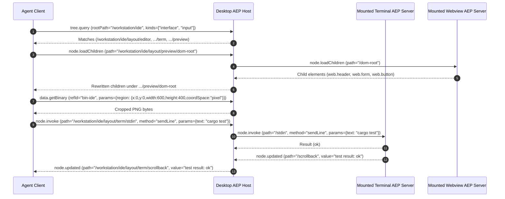
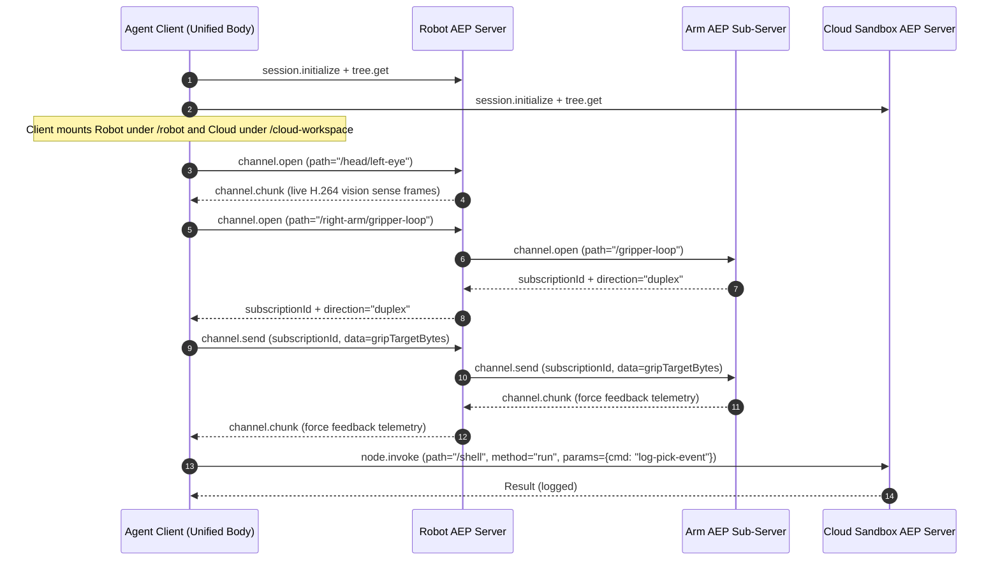
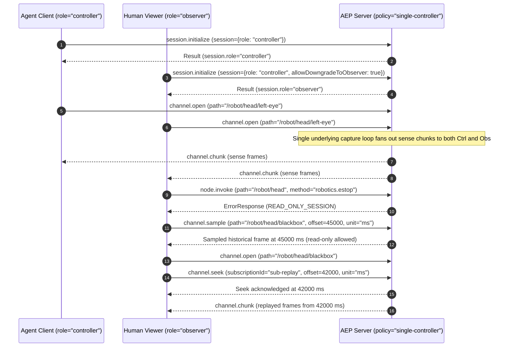

# 07 — Scenarios & Examples

This document walks through three end-to-end scenarios illustrating how the **Agent Environment Protocol (AEP)** formal grammar, transparent passthrough mounting, Control/Data Plane operations, and session roles behave in practice.

Related documents: [01 — Formal Grammar](./01-formal-grammar.md) | [02 — Tree Nodes & Data Model](./02-tree-nodes.md) | [03 — Passthrough & Composition](./03-passthrough-and-composition.md) | [04 — Control & Data Planes](./04-control-and-data-planes.md) | [06 — Profiles, Sessions & Vocabularies](./06-profiles-sessions-and-vocabularies.md)

---

## Scenario 1 — Desktop IDE with Mounted Embedded Terminal & Browser Webview

**Goal**: Inspect a workstation IDE that embeds an out-of-process terminal emulator and an embedded browser preview (`web.iframe`) directly inside structural layout panels, expand lazy DOM subtrees on demand, inspect a cropped screenshot region, and run a command in the terminal.

### Projected AEP Tree

```text
Root
 ├── head:
 │    ├── aep.protocolVersion: "1.0.0-draft"
 │    ├── aep.profiles: ["aep-core-streaming"]
 │    └── aep.vocabularies: ["aep.desktop", "aep.web"]
 └── body
      └── ou#workstation [type="desktop.host"]
           ├── channel#sys-audio [mediaType="audio/opus", direction="sense", deliveryMode="stream"]
           └── interface#ide [type="desktop.window", meta={aep.capture:{binary:true,refId:"bin-ide",regionSupported:true}}]
                └── structure#layout [type="desktop.panel"]
                     ├── input#editor [type="desktop.textField", mediaType="text/plain", value="fn main() {}", methods=[replaceRange, save]]
                     ├── interface#term [type="desktop.terminal"]         <-- transparently mounted terminal AEP server
                     │    ├── content#scrollback [type="desktop.textLog", mediaType="text/plain", temporalMode="dynamic"]
                     │    └── input#stdin [type="desktop.commandInput", mediaType="text/plain", methods=[sendLine]]
                     └── interface#preview [type="web.iframe"]             <-- transparently mounted browser tab AEP server
                          └── structure#dom-root [type="web.page", hasChildren=true]
```

### Interaction Sequence



---

## Scenario 2 — Embodied Robot ("Body of Senses") + Cloud Workspace in One Client Tree

**Goal**: A single AEP client connects simultaneously to a physical robot AEP server (which itself transparently mounts an arm-controller AEP server) and a remote cloud workspace AEP server, assembling one unified tree of senses, actuators, and software tools.

### Client-Side Composite Tree

```text
Root
 ├── head:
 │    ├── aep.protocolVersion: "1.0.0-draft"
 │    ├── aep.profiles: ["aep-core-streaming"]
 │    └── aep.vocabularies: ["aep.robotics", "aep.desktop"]
 └── body
      ├── ou#robot [type="robotics.body", methods=[robotics.estop]]         <-- mounted from Robot AEP Server
      │    ├── ou#head [type="robotics.head"]
      │    │    ├── channel#left-eye  [type="robotics.camera",  mediaType="video/h264", direction="sense", deliveryMode="stream"]
      │    │    ├── channel#right-eye [type="robotics.camera",  mediaType="video/h264", direction="sense", deliveryMode="stream"]
      │    │    ├── channel#ears      [type="robotics.mic",     mediaType="audio/opus", direction="sense", deliveryMode="stream"]
      │    │    └── channel#voice     [type="robotics.speaker", mediaType="audio/opus", direction="act",   deliveryMode="stream"]
      │    └── ou#right-arm [type="robotics.limb"]                         <-- server-side passthrough mount from Arm Controller
      │         ├── channel#joints       [type="robotics.joint",   mediaType="application/x-joints",        direction="sense",  deliveryMode="stream"]
      │         ├── channel#cmd          [type="robotics.joint",   mediaType="application/x-joints",        direction="act",    deliveryMode="stream"]
      │         ├── channel#gripper-loop [type="robotics.gripper", mediaType="application/x-gripper-servo", direction="duplex", deliveryMode="stream"]
      │         └── interface#safety-hud [type="robotics.statusHud"]
      │              ├── content#torque-warning [mediaType="text/plain", temporalMode="dynamic", value="nominal"]
      │              └── input#estop [type="desktop.button", methods=[robotics.estop]]
      └── ou#cloud-workspace [type="desktop.host"]                         <-- mounted from Cloud Sandbox AEP Server
           └── interface#shell [type="desktop.terminal"]
                └── content#stdout [mediaType="text/plain", temporalMode="dynamic"]
```

### Interaction Sequence



---

## Scenario 3 — Multi-User Shared Session (`controller` + `observer`) with `stream+seek`

**Goal**: An autonomous `controller` agent drives an environment while a human supervisor connects as an `observer`, sharing the fanned-out `"sense"` stream and inspecting historical frames via `channel.seek` / `channel.sample` without risking accidental writes.

### Interaction Sequence


