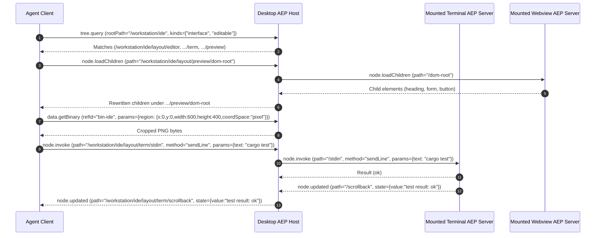
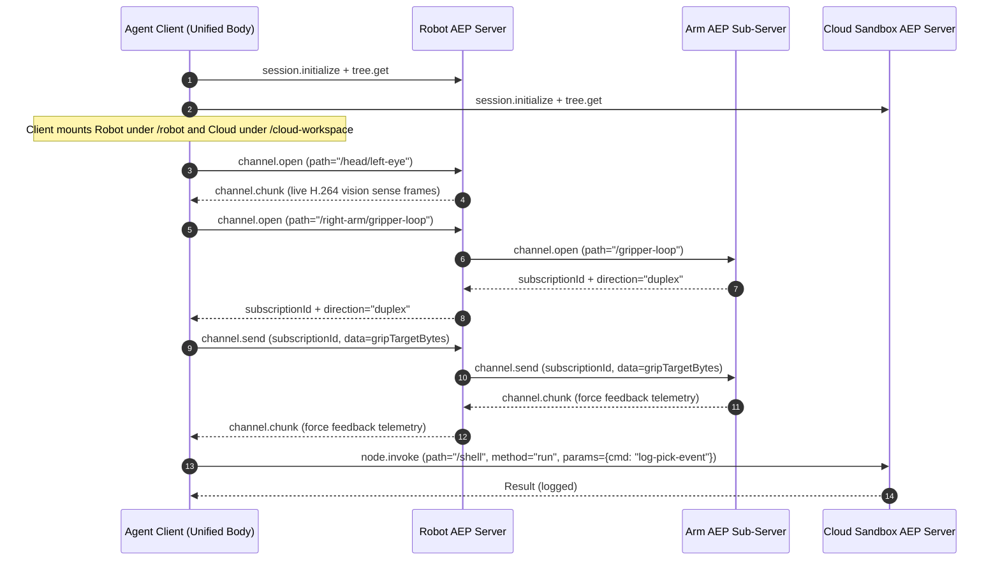
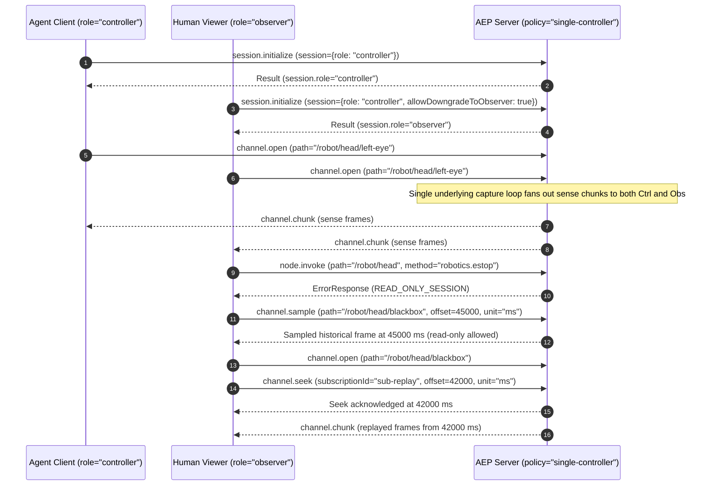
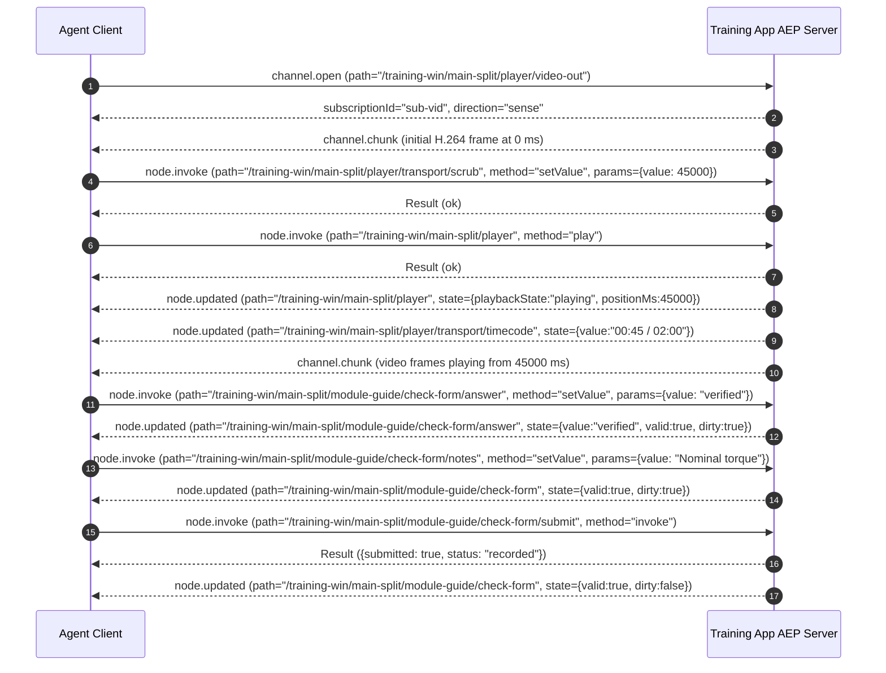
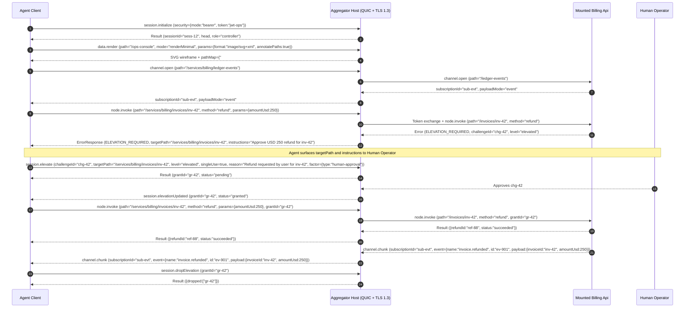

# 07 — Scenarios & Examples

This document walks through six end-to-end scenarios illustrating how the **Agent Environment Protocol (AEP)** formal grammar, XAML-inspired node object model (`properties`, `state`, `methods`, `events`), composite `Component`s, rich `Document`s, headless `Api`/`Endpoint` trees, structured event `Channel`s, multi-tier rendering (`renderMinimal`/`renderExpress`/`renderFull`), transparent passthrough mounting, Control/Data Plane operations, security elevation, and many-to-many load-balanced multi-agent resilience behave in practice.

Related documents: [01 — Formal Grammar](./01-formal-grammar.md) | [02 — Tree Nodes & Data Model](./02-tree-nodes.md) | [03 — Passthrough & Composition](./03-passthrough-and-composition.md) | [04 — Control & Data Planes](./04-control-and-data-planes.md) | [06 — Profiles, Sessions & Vocabularies](./06-profiles-sessions-and-vocabularies.md) | [08 — Security, Authentication & Privilege Elevation](./08-security-and-elevation.md) | [09 — Configuration & Passthrough Mount Manifests](./09-configuration.md)

---

## Scenario 1 — Desktop IDE with Mounted Embedded Terminal & Browser Webview

**Goal**: Inspect a workstation IDE window that embeds an out-of-process terminal emulator and an embedded browser page (`page`) directly inside a layout `grid`, expand lazy document subtrees on demand, inspect a cropped screenshot region, and run a command in the terminal.

### Projected AEP Tree

```text
Root
 ├── head:
 │    ├── aep.protocolVersion: "1.0.0-beta.0"
 │    ├── aep.profiles: ["aep-core-streaming"]
 │    └── aep.vocabularies: ["aep.desktop", "aep.web"]
 └── body
      └── ou#workstation [type="desktop.host"]
           ├── channel#sys-audio [mediaType="audio/opus", direction="sense", deliveryMode="stream"]
           └── interface#ide [type="window", properties={title:"IDE", capture:{binary:true,refId:"bin-ide",regionSupported:true}}]
                └── structure#layout [type="grid", properties={columns:3}]
                     ├── editable#editor [type="textArea", properties={mediaType:"text/plain"}, state={value:"fn main() {}"}, methods=[setValue, replaceRange, save]]
                     ├── interface#term [type="desktop.terminal"]         <-- transparently mounted terminal AEP server
                     │    ├── view#scrollback [type="desktop.textLog", properties={mediaType:"text/plain", temporalMode:"dynamic"}]
                     │    └── editable#stdin [type="desktop.commandInput", properties={mediaType:"text/plain"}, methods=[setValue, sendLine]]
                     └── interface#preview [type="page"]                  <-- transparently mounted browser page AEP server
                          └── document#dom-root [properties={editable:false}, hasChildren=true]
```

### Interaction Sequence



---

## Scenario 2 — Embodied Robot ("Body of Senses") + Cloud Workspace in One Client Tree

**Goal**: A single AEP client connects simultaneously to a physical robot AEP server (which itself transparently mounts an arm-controller AEP server) and a remote cloud workspace AEP server, assembling one unified tree of senses, actuators, and software tools.

### Client-Side Composite Tree

```text
Root
 ├── head:
 │    ├── aep.protocolVersion: "1.0.0-beta.0"
 │    ├── aep.profiles: ["aep-core-streaming"]
 │    └── aep.vocabularies: ["aep.robotics", "aep.desktop"]
 └── body
      ├── ou#robot [type="robotics.body", methods=[robotics.estop]]         <-- mounted from Robot AEP Server
      │    ├── ou#head [type="robotics.head"]
      │    │    ├── channel#left-eye  [type="robotics.camera",  mediaType="video/h264", direction="sense", deliveryMode="stream"]
      │    │    ├── channel#right-eye [type="robotics.camera",  mediaType="video/h264", direction="sense", deliveryMode="stream"]
      │    │    ├── channel#ears      [type="robotics.mic",     mediaType="audio/opus", direction="sense", deliveryMode="stream"]
      │    │    └── channel#voice     [type="robotics.speaker", mediaType="audio/opus", direction="act",   deliveryMode="stream"]
      │    └── ou#right-arm [type="robotics.limb"]                         <-- server-side passthrough mount from Arm Controller
      │         ├── channel#joints       [type="robotics.joint",   mediaType="application/x-joints",        direction="sense",  deliveryMode="stream"]
      │         ├── channel#cmd          [type="robotics.joint",   mediaType="application/x-joints",        direction="act",    deliveryMode="stream"]
      │         ├── channel#gripper-loop [type="robotics.gripper", mediaType="application/x-gripper-servo", direction="duplex", deliveryMode="stream"]
      │         └── interface#safety-hud [type="robotics.statusHud"]
      │              ├── view#torque-warning [type="text", properties={mediaType:"text/plain", temporalMode:"dynamic"}, state={value:"nominal"}]
      │              └── control#estop [type="button", properties={label:"Emergency Stop"}, methods=[invoke, robotics.estop]]
      └── ou#cloud-workspace [type="desktop.host"]                         <-- mounted from Cloud Sandbox AEP Server
           └── interface#shell [type="desktop.terminal"]
                └── view#stdout [type="text", properties={mediaType:"text/plain", temporalMode:"dynamic"}]
```

### Interaction Sequence



---

## Scenario 3 — Multi-User Shared Session (`controller` + `observer`) with `stream+seek`

**Goal**: An autonomous `controller` agent drives an environment while a human supervisor connects as an `observer`, sharing the fanned-out `"sense"` stream and inspecting historical frames via `channel.seek` / `channel.sample` without risking accidental writes.

### Interaction Sequence



---

## Scenario 4 — Composite Video Player `Component` & Rich `Document` with Embedded Fillable `Form`

**Goal**: An agent inspects an operator training `window` containing a two-column `grid`: on the left, a self-contained `media.videoPlayer` `Component` that owns seekable video/audio `Channel`s bound to its `view` viewport alongside standard playback primitives; on the right, a XAML-style rich `Document` combining prose blocks, tabular data, and an embedded interactive `form` whose `editable` fields the agent completes and submits.

### Projected AEP Tree

```text
Root
 ├── head:
 │    ├── aep.protocolVersion: "1.0.0-beta.0"
 │    └── aep.profiles: ["aep-core-streaming"]
 └── body
      └── interface#training-win [type="window", properties={title:"Operator Training Module"}, state={windowState:"normal", focused:true}]
           └── structure#main-split [type="grid", properties={columns:2}]
                ├── component#player [type="media.videoPlayer", state={playbackState:"paused", positionMs:0}, methods=[play, pause, seek]]
                │    ├── channel#video-out [mediaType="video/h264", direction="sense", deliveryMode="stream+seek", streamRef={refId:"vid-1", seek:{seekable:true, unit:"ms", durationMs:120000}}]
                │    ├── channel#audio-out [mediaType="audio/opus", direction="sense", deliveryMode="stream+seek", streamRef={refId:"aud-1", seek:{seekable:true, unit:"ms", durationMs:120000}}]
                │    ├── view#viewport [type="videoSurface", state={channelRef:"/training-win/main-split/player/video-out"}]
                │    └── structure#transport [type="stack", properties={orientation:"horizontal"}]
                │         ├── control#play-pause [type="button", properties={label:"Play"}, methods=[invoke]]
                │         ├── editable#scrub [type="slider", properties={valueSchema:{type:"number", minimum:0, maximum:120000}}, state={value:0}, methods=[setValue]]
                │         ├── editable#subtitles-toggle [type="checkbox", properties={label:"Captions"}, state={value:true}, methods=[setValue, toggle]]
                │         └── view#timecode [type="text", properties={mediaType:"text/plain", temporalMode:"dynamic"}, state={value:"00:00 / 02:00"}]
                └── document#module-guide [properties={title:"Safety & Calibration Guide", editable:false}]
                     ├── structure#h1 [type="heading", properties={level:1}]
                     │    └── view#title [type="text", state={value:"Calibration Checklist"}]
                     ├── structure#intro [type="paragraph"]
                     │    ├── view#lead [type="span", state={value:"Review the telemetry thresholds below, or consult the "}]
                     │    └── control#ref-link [type="link", properties={label:"Reference Manual"}, methods=[invoke]]
                     ├── structure#metrics [type="table"]
                     │    ├── structure#col-param [type="column", properties={label:"Parameter"}]
                     │    ├── structure#col-limit [type="column", properties={label:"Limit"}]
                     │    └── structure#row-1 [type="row"]
                     │         ├── structure#cell-1a [type="cell"]
                     │         │    └── view#v1 [type="text", state={value:"Max Torque"}]
                     │         └── structure#cell-1b [type="cell"]
                     │              └── view#v2 [type="text", state={value:"18.5 Nm"}]
                     └── structure#check-form [type="form", properties={title:"Verification Check"}, state={valid:false, dirty:false}, methods=[submit, reset, validate]]
                          ├── editable#answer [type="radioGroup", properties={label:"Confirm calibration step", required:true, valueSchema:{enum:["verified","needs-service"]}}, state={value:null}, methods=[setValue]]
                          ├── editable#notes [type="textField", properties={label:"Inspector Notes", placeholder:"Optional remarks"}, state={value:""}, methods=[setValue]]
                          └── control#submit [type="button", properties={label:"Submit Check"}, methods=[invoke]]
```

### Interaction Sequence



---

## Scenario 5 — Headless Billing `Api`, Structured Event `Channel`, `renderMinimal` Grounding & Step-Up Elevation

**Goal**: An autonomous agent connects over QUIC (`TLS 1.3`, `bearer` auth) to a workstation aggregator that mounts an admin `Interface` alongside a headless `Api` (`billing`) via `token-exchange`. The agent obtains a low-token `renderMinimal` wireframe with `annotatePaths` for the admin window, inspects and invokes a headless `Endpoint`, responds to an `ELEVATION_REQUIRED` challenge via `session.elevate`, subscribes to a plain structured event stream (`payloadMode = "event"`), and drops its elevated grant immediately afterward.

### Projected AEP Tree

```text
Root
 ├── head:
 │    ├── aep.protocolVersion: "1.0.0-beta.0"
 │    ├── aep.profiles: ["aep-core-streaming"]
 │    ├── aep.vocabularies: ["aep.desktop", "aep.api"]
 │    └── aep.security: {mode: "bearer", principal: {id: "agent-ops-1"}, sessionAuthenticated: true}
 └── body
      ├── interface#ops-console [type="window", properties={title:"Ops Console", capture:{binary:true, modes:["renderMinimal","renderExpress","renderFull"]}}]
      │    └── structure#toolbar [type="stack", properties={orientation:"horizontal"}]
      │         ├── editable#filter [type="searchField", properties={label:"Invoice Filter"}, state={value:"inv-42"}, methods=[setValue]]
      │         └── control#refresh [type="button", properties={label:"Refresh"}, methods=[invoke]]
      └── ou#services
           └── api#billing [type="rest", properties={title:"Billing Service", version:"2026-10-01"}, state={status:"healthy"}]
                ├── channel#ledger-events [mediaType="application/aep+event", direction="sense", deliveryMode="stream+seek", payloadMode="event", streamRef={refId:"evt-ledger", seek:{seekable:true, unit:"events"}}]
                └── endpoint#invoices [type="collection", hasChildren=true, methods=[list, create]]
                     └── endpoint#inv-42 [type="resource", state={value:{id:"inv-42", amountUsd:250, status:"paid"}}, methods=[get, refund (elevation={level:"elevated", allowedFactors:["human-approval"], requireReason:true})]]
```

### Interaction Sequence



---

## Scenario 6 — Multi-Agent (System 1 + System 2) Cloud Console Behind a Load-Balanced Passthrough Gateway

**Goal**: Two concurrent `multi-controller` agent sessions—a fast **System 1** telemetry/reflex agent (`sess-s1`) and a deliberative **System 2** deployment planner (`sess-s2`)—operate simultaneously against a distributed cloud console behind a load-balanced passthrough gateway. System 2 acquires an exclusive lease on `/aws/us-east-1/ecs/cluster-prod`, a backend shard rebalance relocates an endpoint from `/aws/us-east-1/ecs/cluster-prod/svc-web` to `/aws/us-west-2/ecs/cluster-prod/svc-web` (`node.moved`) without breaking System 1's active event `subscriptionId`, and System 2 survives a gateway replica swap seamlessly using `session.resume`.

### Projected AEP Tree

```text
Root
 ├── head:
 │    ├── aep.protocolVersion: "1.0.0-beta.0"
 │    ├── aep.profiles: ["aep-core-streaming"]
 │    └── aep.capabilities.sessions: {policy: "multi-controller", leases: true, optimisticConcurrency: true}
 └── body
      └── ou#aws [uid="aws-root", type="cloud.provider"]
           └── ou#us-east-1 [uid="reg-east-1", type="cloud.region"]
                ├── channel#cloudwatch-events [uid="cw-stream", mediaType="application/aep+event", direction="sense", deliveryMode="stream+seek", payloadMode="event"]
                └── api#ecs [uid="ecs-api", type="rest"]
                     └── endpoint#cluster-prod [uid="ecs-cluster-prod", type="collection", revision=14]
                          └── endpoint#svc-web [uid="ecs-svc-web", type="resource", revision=7, methods=[scale, deploy]]
```

### Interaction Sequence

```mermaid
sequenceDiagram
    autonumber
    participant S1 as System 1 Agent (sess-s1)
    participant S2 as System 2 Agent (sess-s2)
    participant GW1 as Gateway Replica A
    participant GW2 as Gateway Replica B
    participant Cloud as Backend Pool (ECS Shards)

    S1->>GW1: session.initialize (role="controller")
    GW1-->>S1: Result (sessionId="sess-s1", resumeToken="rt-s1")
    S1->>GW1: channel.open (path="/aws/us-east-1/cloudwatch-events")
    GW1-->>S1: subscriptionId="sub-cw", payloadMode="event"

    S2->>GW1: session.initialize (role="controller")
    GW1-->>S2: Result (sessionId="sess-s2", resumeToken="rt-s2")
    S2->>GW1: session.acquireLease (path="/aws/us-east-1/ecs/cluster-prod", mode="exclusive-write", durationMs=60000, holderName="planner-s2")
    GW1-->>S2: Result (leaseId="lease-9")
    GW1-->>S1: session.leaseUpdated (path="/aws/us-east-1/ecs/cluster-prod", status="acquired", seq=12)

    Note over Cloud,GW1: Backend shard rebalances svc-web to us-west-2 while streaming continues
    Cloud-->>GW1: node.moved (fromPath="/ecs/cluster-prod/svc-web", toPath="/us-west-2/ecs/cluster-prod/svc-web", uid="ecs-svc-web")
    GW1-->>S1: node.moved (fromPath="/aws/us-east-1/ecs/cluster-prod/svc-web", toPath="/aws/us-west-2/ecs/cluster-prod/svc-web", uid="m:aws:ecs-svc-web", seq=13)
    GW1-->>S2: node.moved (fromPath="/aws/us-east-1/ecs/cluster-prod/svc-web", toPath="/aws/us-west-2/ecs/cluster-prod/svc-web", uid="m:aws:ecs-svc-web", seq=13)
    GW1-->>S1: channel.chunk (subscriptionId="sub-cw", event={name:"ecs.rebalanced", payload:{uid:"m:aws:ecs-svc-web"}})

    Note over S2,GW2: Load balancer drops GW1 connection; S2 reconnects to GW2
    S2->>GW2: session.resume (sessionId="sess-s2", resumeToken="rt-s2", lastControlSeq=12)
    GW2-->>S2: Result (resumed=true, currentControlSeq=13, replayedCount=1)

    S2->>GW2: node.invoke (uid="m:aws:ecs-svc-web", followMoves=true, method="scale", params={desiredCount:6}, expectedRevision=7, leaseId="lease-9")
    GW2->>Cloud: Route to relocated shard + verify revision & lease
    Cloud-->>GW2: Result (revision=8, status="scaling")
    GW2-->>S2: Result (resolvedPath="/aws/us-west-2/ecs/cluster-prod/svc-web", revision=8)
```
