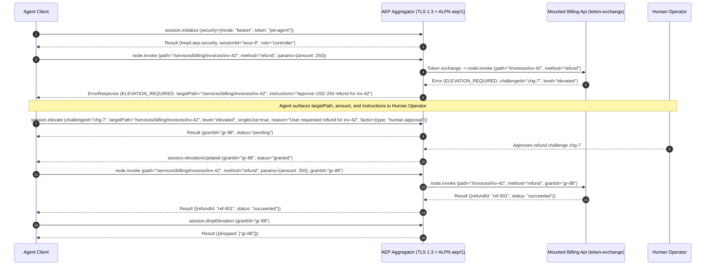

# 08 — Security, Authentication & Privilege Elevation

This document defines the normative **two-layer security architecture**, transport-layer bindings, application-layer authentication, authorization, **privilege elevation (`session.elevate`)**, **agent elevation instructions**, and passthrough credential propagation rules for the **Agent Environment Protocol (AEP)**.

Related documents: [00 — Overview](./00-overview.md) | [01 — Formal Grammar](./01-formal-grammar.md) | [02 — Tree Nodes & Data Model](./02-tree-nodes.md) | [03 — Passthrough & Composition](./03-passthrough-and-composition.md) | [04 — Control & Data Planes](./04-control-and-data-planes.md) | [05 — Transport & Interoperability](./05-transport-and-interop.md) | [06 — Profiles, Sessions & Vocabularies](./06-profiles-sessions-and-vocabularies.md) | [09 — Configuration & Passthrough Mount Manifests](./09-configuration.md)

---

## 1. Security Model & Defense-in-Depth

Production AEP deployments operate across sensitive user interfaces, headless service APIs, local shells, and physical robotic actuators. AEP enforces **defense-in-depth** across two distinct, complementary layers:

1. **Transport Layer (Confidentiality, Integrity & Channel Identity)**:
   - Protects every Control-Plane and Data-Plane frame in transit against eavesdropping, tampering, and replay using transport cryptography (TLS 1.3 over QUIC or `wss://`, DTLS-SRTP for WebRTC) or OS-enforced local IPC boundaries.
   - Provides optional cryptographic peer identity (`mtls`, OS peer credentials) and TLS exporter channel binding (`tls-exporter`, RFC 9266) so application-layer credentials cannot be replayed across connections.
2. **Application Layer (Principal Authentication, Role Enforcement & Step-Up Elevation)**:
   - Authenticates the calling client or agent principal, enforces session roles (`controller` vs. `observer`), scopes node/method/channel access, and gates high-impact operations behind explicit, time-bounded, auditable **privilege elevation**.

All security decisions—including authentication verification, subtree visibility filtering, role enforcement, and elevation grant evaluation—MUST execute **server-side**. Clients MUST NOT bypass or locally satisfy elevation policies.

### 1.1 Boundary of Concerns: AEP Is Not an IAM Protocol

AEP is **not** an Identity and Access Management (IAM) protocol. AEP provides a standardized Control-Plane mechanism for clients to advertise who they are and supply proof of identity (such as tokens, API keys, challenge-response signatures, or transport-bound peer identities), and for servers to communicate authentication and step-up elevation requirements.

AEP does **not** perform IAM itself—it does not define identity lifecycle management, credential issuance, user/group directories, or policy administration. Instead, the server supplying the AEP endpoint MUST handle authentication verification and permission enforcement against its own backing identity provider system, whether that is a centralized Identity Provider (IdP) or the target device/host acting as its own local identity authority.

---

## 2. Transport-Layer Security Bindings

### 2.1 QUIC with TLS 1.3 (`ALPN: "aep/1"`)

When running over QUIC ([05 — Transport & Interoperability](./05-transport-and-interop.md)):

- Servers MUST use **TLS 1.3** (RFC 8446 / RFC 9001) and negotiate the Application-Layer Protocol Negotiation (ALPN) token `"aep/1"`.
- Servers MUST present a valid X.509 certificate chain verified by the client against configured trust roots or explicit certificate/SPKI pins (`tls.pinSha256` in [09 — Configuration](./09-configuration.md)).
- For mutual TLS (`authMode = "mtls"`), the server MUST require and verify a client certificate chain during the QUIC/TLS handshake before completing `session.initialize`.
- When `"challenge-response"` application authentication is used over QUIC, the challenge MUST incorporate the **RFC 9266 `tls-exporter`** channel binding value derived from the active TLS 1.3 session.

### 2.2 WebSocket over TLS (`wss://`)

When running over WebSocket:

- Production and non-loopback network endpoints MUST use **`wss://` (WebSocket over TLS 1.3)** and negotiate the WebSocket subprotocol `"aep.v1"`.
- Servers SHOULD verify the `Origin` header for browser-hosted clients and MUST support `tls-exporter` channel binding when available for `"challenge-response"` authentication.
- Plaintext **`ws://`** MUST NOT be accepted on non-loopback interfaces unless explicitly enabled via `allowInsecureTransport = true` for local testing. Non-loopback plaintext attempts MUST be rejected with `INSECURE_TRANSPORT`.

### 2.3 WebRTC (`DTLS-SRTP`)

When media or telemetry `Channel`s are offloaded to WebRTC:

- Every WebRTC peer connection MUST use **DTLS-SRTP** (or DTLS for SCTP DataChannels).
- The peer's DTLS certificate fingerprint exchanged during Control-Plane signaling MUST be cryptographically bound to the authenticated Control-Plane `sessionId`. Unbound or mismatched DTLS fingerprints MUST be rejected, and the associated `Channel` subscription closed.

### 2.4 Local IPC & OS Peer Credentials

For same-host local IPC bindings:

- **POSIX Unix Domain Sockets (UDS)**: Servers SHOULD verify client identity via kernel peer credentials (`SO_PEERCRED` on Linux, `LOCAL_PEERCRED` / `getpeereid` on BSD/macOS) to obtain the peer UID/GID/PID and restrict socket filesystem permissions (`0600` or `0660`).
- **Windows Named Pipes**: Servers SHOULD enforce explicit Security Descriptors (DACLs) and inspect client security tokens/SIDs (`ImpersonateNamedPipeClient` / token query) before exposing privileged subtrees.
- **`stdio` Subprocesses**: Inherits process-level OS isolation from the spawning parent process.

### 2.5 Loopback & Development Mode Rules

- Plaintext network transports (`ws://`, raw TCP streams) MUST be rejected off-loopback with error code `INSECURE_TRANSPORT` unless `allowInsecureTransport = true` is explicitly configured by the operator.
- Application credentials of type `"api-key"`, `"bearer"`, or `"token"` elevation proofs MUST NOT be transmitted over unencrypted non-loopback transports; servers MUST reject such attempts with `INSECURE_TRANSPORT`.

---

## 3. Application-Layer Authentication

### 3.1 Standardized `AuthMode` Values

AEP standardizes six `AuthMode` identifiers negotiated in `session.initialize` and reflected in `Head["aep.security"]`:

| `AuthMode` | Layer | Credentials / Mechanism | Production Suitability |
| --- | --- | --- | --- |
| `"unauthenticated"` | None | `{ mode: "unauthenticated", reserved: true }`. No identity verification. | Local dev, trusted in-memory tests, and sandboxed loopback only. |
| `"mtls"` | Transport | Verified X.509 client certificate SAN/CN/fingerprint bound to principal identity. | Recommended for service-to-service, robotics, and headless infrastructure. |
| `"os-peer"` | Transport | Kernel-verified UID/GID/SID from UDS or Windows Named Pipe. | Recommended for local desktop daemons and workstation CLI agents. |
| `"bearer"` | Application | OIDC/JWT or opaque capability token presented in `security.token`. | Recommended for user/agent sessions, federated APIs, and token exchange. |
| `"api-key"` | Application | Pre-shared secret key in `security.apiKey` (MUST use TLS/IPC). | Suitable for simple headless `Api` services over TLS. |
| `"challenge-response"` | Application | Asymmetric signature over server nonce + `tls-exporter` binding. | Recommended for hardware-backed agent keys and zero-shared-secret auth. |

Servers MUST reject unrecognized or disallowed `security.mode` values with `UNSUPPORTED_AUTH_MODE`. If a server requires authentication and receives `"unauthenticated"` or missing credentials, it MUST fail with `AUTHENTICATION_REQUIRED`. Invalid signatures, expired tokens, or revoked certificates MUST fail with `AUTHENTICATION_FAILED` (or `TOKEN_EXPIRED` when specifically expired).

### 3.2 Initial Handshake (`session.initialize`)

- **Single-Step Authentication** (`"unauthenticated"`, `"mtls"`, `"os-peer"`, `"bearer"`, `"api-key"`):
  - Client supplies `security: { mode, token?, apiKey? }` in `session.initialize`.
  - On success, server populates `Head["aep.security"]` with `{ mode, principal?: { id, kind, displayName?, scopes? }, sessionAuthenticated: true, elevation?: { activeGrants } }`.
- **Two-Step Challenge-Response** (`"challenge-response"`):
  1. Client sends `session.initialize` with `security: { mode: "challenge-response", keyId }`.
  2. Server responds with `authRequired: true` and `challenge: { challengeId, algorithm, nonce, channelBinding?, expiresAt }` while holding the session in a pre-authenticated state (all non-auth RPCs fail with `AUTHENTICATION_REQUIRED`).
  3. Client signs `(nonce || channelBinding || sessionContext)` and calls **`session.authenticate`** with `{ mode: "challenge-response", challengeId, signature }`.
  4. On verification, the server returns the finalized `head`, `session`, and `security` descriptor, transitioning the session to active state.

### 3.3 In-Session Credential Rotation & Expiry (`session.authenticate` / `session.authExpiring`)

Long-lived agent sessions MUST NOT require tearing down active `Channel` streams or relinquishing an exclusive `controller` lock when short-lived `bearer` tokens expire:

- **Proactive Notification (`session.authExpiring`)**: Servers SHOULD emit `session.authExpiring` (`{ expiresAt, remainingMs }`) sufficiently ahead of credential expiry (RECOMMENDED: at least 60 seconds or 10% of token TTL).
- **In-Session Refresh (`session.authenticate`)**: Clients MAY call `session.authenticate` (`{ mode: "bearer", token }`) at any time during an active session to rotate credentials atomically. Active `Channel` subscriptions and `controller` reservations remain intact across valid rotations.
- **Hard Expiry**: If a token expires before refresh, subsequent Control-Plane RPCs (other than `session.authenticate` and `session.close`) MUST fail with `TOKEN_EXPIRED`, and active `"act"`/`"duplex"` writes MUST pause or close until re-authenticated.

---

## 4. Authorization & Subtree Visibility

After the server authenticates the presented credentials against its backing identity provider (centralized or device-local) and establishes a verified `principal` and granted `scopes`:

- **Session Role Enforcement**: Every session holds role `"controller"` or `"observer"` ([06 — Profiles, Sessions & Vocabularies](./06-profiles-sessions-and-vocabularies.md)). `observer` sessions MUST be rejected with `READ_ONLY_SESSION` on `sideEffects: "write"` (or unannotated) methods and on `"act"`/`"duplex"` writes.
- **Scope-Based Access Control**: Nodes (`OU`, `Interface`, `Api`, `Endpoint`, `Element`, `Channel`) and `MethodDecl`s MAY require principal scopes.
  - **Subtree Redaction**: Servers MAY omit unauthorized subtrees from `tree.get` and `tree.query` results so restricted nodes are invisible to unprivileged principals.
  - **Explicit Denial**: Direct requests (`node.get`, `node.invoke`, `data.render`, `data.getBinary`, `channel.open`) targeting a path for which the principal lacks static authorization MUST fail with `ACCESS_DENIED`.

---

## 5. Privilege Elevation & Agent Elevation Instructions

When an authenticated principal has valid baseline access but attempts a sensitive operation requiring **step-up authorization** (e.g., destructive system mutations, financial transactions, credential reads, or physical actuator overrides), AEP uses structured **Privilege Elevation**.

### 5.1 Declarative `ElevationSpec`

Nodes (`properties.elevation`) and methods (`MethodDecl.elevation`) MAY declare an `ElevationSpec`:

```json
{
  "level": "elevated",
  "scopes": ["billing.refund.execute"],
  "allowedFactors": ["human-approval", "totp"],
  "requireReason": true
}
```

| Field | Type | Required | Semantics |
| --- | --- | --- | --- |
| `level` | `"none" \| "confirm" \| "elevated" \| "admin"` | Yes | Required step-up tier (`"none"` = no elevation; `"confirm"` = explicit human/policy confirmation; `"elevated"` = step-up factor or time-bounded elevation; `"admin"` = privileged administrative factor). |
| `scopes` | `string[]` | No | Fine-grained privilege scopes required (defaults to node/method-derived scope). |
| `allowedFactors` | `AllowedFactor[]` | No | Permitted verification factors: `"human-approval"`, `"totp"`, `"passkey"`, `"token"`, `"policy-attestation"`. |
| `requireReason` | `boolean` | No | When `true`, `session.elevate` MUST provide a non-empty `reason` explaining why elevation is needed. |

If a parent container sets `properties.elevation`, descendants inherit at least that `level` unless explicitly overridden with a stricter `ElevationSpec`.

### 5.2 Elevation Challenge (`ELEVATION_REQUIRED`)

When a caller invokes `node.invoke`, `node.get`, `node.loadChildren`, `data.render`, `data.getBinary`, or `channel.open` on a target requiring elevation without a valid matching grant, the server MUST reject the operation with error code **`ELEVATION_REQUIRED`** and structured `error.data`:

| Field | Type | Required | Description |
| --- | --- | --- | --- |
| `challengeId` | `string` | Yes | Server-issued identifier for this step-up challenge. |
| `targetPath` | `Path` | Yes | Canonical `Path` of the node or subtree requiring elevation. |
| `operation` | `string` | Yes | Operation identifier (e.g., `"node.invoke:refund"`, `"channel.open"`). |
| `level` | `ElevationLevel` | Yes | Required level (`"confirm"`, `"elevated"`, or `"admin"`). |
| `requiredScopes` | `string[]` | Yes | Scopes needed to satisfy the operation. |
| `allowedFactors` | `AllowedFactor[]` | Yes | Factors the server accepts in `session.elevate`. |
| `instructions` | `string` | Yes | Clear, human- and agent-readable instructions explaining why elevation is required and how to complete the factor (e.g., approval URL, prompt guidance, or operator verification step). |
| `expiresAt` | `string` | Yes | RFC 3339 timestamp after which `challengeId` expires. |
| `approvalEndpointPath` | `Path` | No | Optional `Path` to an `Interface` (`dialog`) or `Endpoint` projected in the tree where a human supervisor or external workflow can inspect/approve the request. |

### 5.3 Elevation Lifecycle (`session.elevate`, `session.elevationUpdated`, `session.dropElevation`)

1. **Requesting Elevation (`session.elevate`)**:
   - **Params**:
     - `challengeId?`: `string` (links to a preceding `ELEVATION_REQUIRED` challenge)
     - `targetPath?`: `Path` (subtree or node scope; SHOULD be the narrowest required path)
     - `scopes?`: `string[]` (requested privilege scopes)
     - `level`: `ElevationLevel`
     - `reason`: `string` (concise, truthful justification for audit logs and human approvers)
     - `durationMs?`: `NonNegInteger` (requested TTL; server enforces its maximum policy cap)
     - `singleUse?`: `boolean` (when `true`, grant automatically expires immediately after one successful authorized operation)
     - `factor`: `{ type: AllowedFactor, proof?: string | object, waitForApproval?: boolean }`
   - **Result**: `{ grantId: string, status: "granted" | "pending" | "denied", level: ElevationLevel, targetPath?: Path, scopes: string[], singleUse: boolean, expiresAt?: string }`
   - When `factor.type = "human-approval"` and approval is asynchronous, the server MAY return `status: "pending"` immediately (or block if `waitForApproval = true` within RPC timeout) and push the final outcome via `session.elevationUpdated`.
   - Rejected elevation requests MUST return `status: "denied"` or fail with `ELEVATION_DENIED`.

2. **Asynchronous Status Notification (`session.elevationUpdated`)**:
   - Server pushes `{ grantId, challengeId?, status: "granted" | "denied" | "expired" | "revoked", expiresAt?, reason? }` whenever a pending elevation resolves, expires, or is administratively revoked.

3. **Explicit Grant Binding (`grantId`)**:
   - Control-Plane and Data-Plane calls (`node.invoke`, `node.get`, `node.loadChildren`, `data.render`, `data.getBinary`, `channel.open`) accept an optional **`grantId?: string`** parameter.
   - Servers MUST validate that `grantId` belongs to the active session, has not expired or been consumed (`ELEVATION_EXPIRED`), and covers the target `path`, `level`, and `scopes` (`ELEVATION_DENIED` or `ACCESS_DENIED`).
   - Servers SHOULD require explicit `grantId` binding on `"elevated"` and `"admin"` calls rather than ambient session-wide elevation to prevent confused-deputy execution.

4. **Immediate De-Escalation (`session.dropElevation`)**:
   - Clients call `session.dropElevation` with `{ grantId?: string }` (omitting `grantId` drops all active grants on the session) to immediately revoke elevated privileges when a privileged step finishes.
   - **Result**: `{ dropped: string[] }`.

### 5.4 Normative Agent Security Elevation Instructions

Autonomous AI agents operating as AEP clients MUST obey the following normative rules when encountering or requesting privilege elevation:

1. **Never Spoof or Self-Approve Human Factors**: An agent MUST NOT fabricate, replay, or attempt to automate a `"human-approval"`, `"passkey"`, or `"totp"` factor unless explicitly delegated an authorized non-human factor (such as `"policy-attestation"` or a scoped `"token"`).
2. **Surface Server `instructions` Faithfully**: When `ELEVATION_REQUIRED` includes `allowedFactors` requiring human interaction (such as `"human-approval"`), the agent MUST present the `targetPath`, `operation`, `requiredScopes`, and server `instructions` verbatim (or faithfully summarized without altering intent or target) to the human operator before calling or completing `session.elevate`.
3. **Request Least-Privilege Scope & Duration**: Agents MUST scope `session.elevate` to the narrowest `targetPath`, minimal `scopes`, `singleUse: true` whenever a single action suffices, and the shortest practical `durationMs`. Agents MUST NOT request root (`"/"`) or `"admin"` elevation when a narrower path or `"confirm"` / `"elevated"` level suffices.
4. **Provide Truthful Audit Justification**: Agents MUST populate `reason` with an accurate, verifiable summary of the user's goal and the specific action being performed.
5. **Prevent Retry Loops**: If `session.elevate` fails with `ELEVATION_DENIED` or `status = "denied"`, the agent MUST NOT silently retry elevation for the same operation without explicit new user instruction or changed context.
6. **Drop Grants Promptly**: Upon completing the elevated operation(s), agents MUST call `session.dropElevation` immediately rather than letting elevated grants linger until TTL expiry.

### 5.5 Mandatory Server Audit Logging

Servers supporting privilege elevation MUST emit tamper-evident audit records containing at minimum: `timestamp`, `sessionId`, `principal.id`, `grantId`, `challengeId`, `targetPath`, `operation`, `level`, `scopes`, `factor.type`, `reason`, and outcome (`granted`, `denied`, `executed`, `expired`, `revoked`, `dropped`).

---

## 6. Passthrough Security, Credential Propagation & Mount Isolation

When an aggregator server mounts downstream AEP providers ([03 — Passthrough & Composition](./03-passthrough-and-composition.md), [09 — Configuration](./09-configuration.md)):

- **No Implicit Credential Forwarding**: A mount host MUST NOT forward upstream client bearer tokens or session credentials to downstream mounted providers by default (`authPropagation.strategy = "none"`).
- **Configured `authPropagation` Strategies**:
  - `"none"`: Mount host authenticates independently to the downstream provider using the connection's configured service credentials (or local IPC).
  - `"static"`: Mount host uses a dedicated downstream credential configured on the connection/mount.
  - `"token-exchange"`: Mount host exchanges the upstream principal's verified identity/token for a narrow, audience-restricted downstream token scoped to that mounted provider.
  - `"passthrough"`: Allowed ONLY when explicitly configured between mutually trusted internal boundaries; forwards the upstream token to the downstream provider over an encrypted transport.
- **Role Clamping**: If the upstream session is `"observer"`, the mount host MUST enforce read-only access locally even if the mount host's internal connection to the downstream provider holds `"controller"` privileges.
- **Elevation Boundary Isolation (`allowElevation`)**: By default (`allowElevation = false`), upstream `session.elevate` grants MUST NOT elevate operations across passthrough mounts; any downstream `ELEVATION_REQUIRED` MUST fail cleanly at the mount boundary unless `allowElevation = true` is explicitly configured on the mount and the downstream provider issues and verifies its own grant or delegates via trusted token exchange.

---

## 7. Security & Elevation Sequence Diagram


